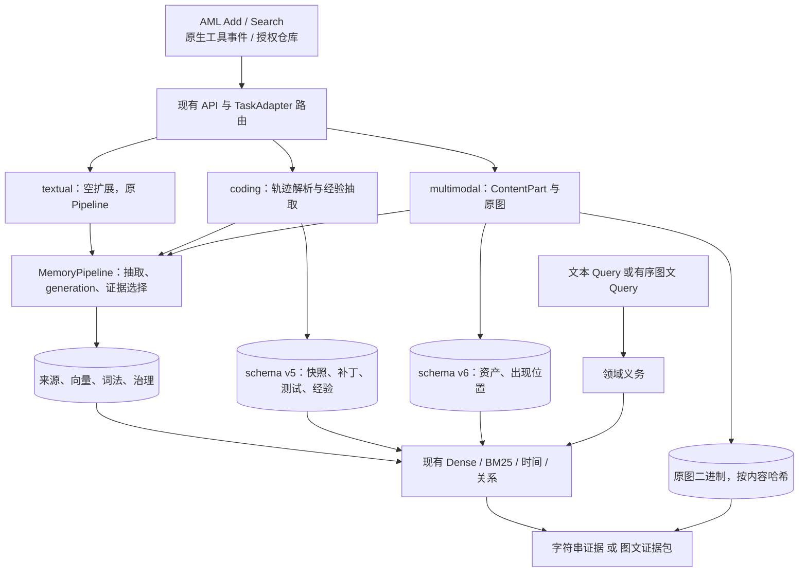

# EviEpoch Coding / Multimodal 原型设计

**版本：** 0.1 原型合同。范围窄于 [技术设计 §18–§23](TECHNICAL_DESIGN.md#18-三赛道共享核心与扩展边界)

**日期：** 2026-11-03，Asia/Shanghai

**产品合同：** [PRD](PRD.md)
**共享核心：** [技术设计 §1–§17](TECHNICAL_DESIGN.md#1-技术主张)
**依据：** 用户给出的 Coding / Multimodal 扩展说明 · [Coding / Multimodal 源码审阅](CODING_MULTIMODAL_SOURCE_REVIEW.md) · [实现与验收状态](IMPLEMENTATION_STATUS.md)

本文定义要在现有文本记忆服务上搭出的两个可运行原型。§1–§15 沿用共享核心的章节职责：主张、架构、对象、时间、巩固、经验、写入、检索、装配、治理、存储、成本、评测、运行与代码迁移。对象与协议的完整目标仍以技术设计 §19–§23 为准；本文只固定最小闭环、每次引入的一种机制，以及怎样用真实任务验收。

当前 `TaskAdapter`、schema v5/v6 与合成往返测试是起点。架构说明、对象表和只走合成 Provider 的测试说明合同能跑通。原型完成是指：有可实际运行的用例、有对照实验、有真实新增源码，失败的实验臂一并留档。文中的榜单百分比来自用户对第一届 Coding Memory 的解读，是外部任务解决率观察，不是本仓库的测试成绩。

## 1. 技术主张

在现有来源、generation、混合检索和证据选择之上，用两个领域适配器分别闭合一条可测链路。

Coding 原型是 **带仓库版本约束的情景与程序记忆**。它同时保存一次工程任务的完整轨迹，以及从轨迹抽出的短经验：为何这样修、怎样验证、在什么条件下不能复用。查询要恢复同一仓库的实现背景、调试、失败尝试、测试和技术决策。Feature 与 Bug Fix 取回的经验类型可以不同。语义相近的旧修复，在 commit 或模块已经变化时，只作为带来源的历史，不作为当前补丁。

Multimodal 原型是 **保留原图的图文证据记忆**。Add、Search query 与 Search 响应按 AML 的有序 `ContentPart[]` 传递文本和图像。Caption 与 OCR 绑定到原图来源；原图按内容哈希独立保存，并在证据包中与相关来源文本一起返回。细粒度视觉细节和跨时间视觉变化是首批要测的问题。

两条原型共享这些执行原则：

1. 适配器产生领域对象和候选，核心 Pipeline 继续负责幂等、namespace、generation、来源依赖和文本证据选择。
2. 每次实验只多打开一种机制。前一臂的结果，包括失败，保留后再进入下一臂。
3. 默认 `task_adapter=textual` 时，文本赛道的 Add/Search 行为保持不变。
4. 参考系统迁移机制与字段。榜单分数、论文结论和未运行的上游配置不写入本仓库的已测结果。

## 2. 系统架构

官方请求没有必填 track 字段。适配器由部署配置 `EPOCH_TASK_ADAPTER` 绑定为 `textual | coding | multimodal`。标准请求不增加 repository、commit 或本机路径等必填参数；这些身份从消息、原生事件或实验 harness 的已授权输入中解析，并保持在 `user_id` 对应的 namespace 之内。

### 2.1 组件选型

| 组件 | 原型中的职责 |
|---|---|
| 共享核心 | 继续使用 `pipeline.py`、`retrieval/engine.py`、PostgreSQL/pgvector 与 SQLite 验证适配器 |
| Coding 适配器 | 解析工具轨迹、diff、测试输出；写工程对象；在 Search 中增加仓库/符号、版本适用性和成败重排 |
| Multimodal 适配器 | 校验有序 ContentPart；原图落盘；Caption/OCR 来源绑定；图文证据装配 |
| 文本适配器 | 空扩展。文本回归以此配置为守门 |
| 参考运行时 | claude-mem 的 Hook、Observation 和渐进披露作为行为对照；其 TypeScript worker 与 Chroma 不进入 Python 服务 |
| 评测入口 | `experiments/` 下的 Coding 任务运行器与 MemEye 方法适配。合成 Provider 只覆盖合同测试 |
| 模型 | 文本抽取与 embedding 沿用现有政策。视觉 embedding 使用独立表示身份，与 `text-embedding-v4` 分集合 |

建议中的 `eviepoch/domains/` 目录是目标草图。第一轮原型长在已有的 `eviepoch/adapters/coding/`、`eviepoch/adapters/multimodal/` 和 `experiments/` 上，不把领域分支写进文本 Pipeline 的主路径。

## 3. 数据模型与不变量

### 3.1 权威对象

Coding 写入对象覆盖 Repository、Commit、Symbol、Issue、Patch、Test、Observation、Procedure、Experience。第一轮使用已有工程类型，不另建通用图节点种类。

| 对象 | 必须留下的内容 |
|---|---|
| Repository | namespace、repo_id、可核验 remote 或显式项目标识、身份来源。目录名不足以唯一标识仓库 |
| RepositorySnapshot | repo_id、commit_sha、tree_sha、parent、dirty overlay。缺少可核验 SHA 时标记 provisional |
| Symbol / FileRevision | 快照、相对路径、限定名、签名或片段哈希、来源 span |
| EngineeringEvent | 会话、轮次、工具名、输入/输出 span、cwd、事件时间、前后快照 |
| PatchAttempt | 基线快照、原始 diff、patch 哈希、作用文件/符号、是否应用、结果来源 |
| TestRun | 命令、运行时所在快照、退出码、输出 span、成功/失败/混合/未知 |
| Observation | bugfix / feature / discovery / decision / refactor / change，以及 facts、读改文件和来源 span |
| Procedure / Experience | 问题、前提、步骤、验证标准、失败回退、适用版本、支持与反例 |

四种使用语义覆盖查询，字段仍落在上表对象中：

| 语义 | 实际保存什么 | 查询时解决的问题 |
|---|---|---|
| Repository | 模块、符号、依赖、架构约束、commit | 当前任务应该修改哪里 |
| Debug | 现象、根因、失败尝试、最终补丁、回归测试 | 以前是否解决过类似缺陷 |
| Procedure | 步骤、先决条件、验证标准、失败回退 | 该类任务怎样可靠执行 |
| Development | 设计取舍、实现过程、技术债 | 怎样沿仓库既有设计扩展功能 |

存储分成两层，并都能回到来源：

1. **保真轨迹。** 任务、工具入参与返回、diff、测试输出和失败尝试按原始来源保存。
2. **短经验。** 从轨迹抽出可复用的修复理由、操作规则和禁止复用的条件。短经验持有轨迹对象与 span 的依赖。

Multimodal 在字符串来源之外增加有序内容与媒体身份：

| 对象 | 必须留下的内容 |
|---|---|
| SourceContentPart | source、part 序号、text 或图像引用。重建时保持顺序 |
| MediaAsset | namespace、内容哈希、真实 MIME、解码字节数、尺寸、二进制位置 |
| MediaOccurrence | 同一资产出现在哪条消息的哪个 part、角色与时间。相同字节的多次出现保留各自情境 |
| VisualObservation | Caption、OCR、实体、颜色与空间字段。每个字段带 origin：用户原文、OCR 或视觉模型观察 |
| Representation | 所属对象、视图种类、模型/修订、维度、预处理版本 |

图像区域、实体、事实和时间的关联在 M3 才作为实验机制打开。M0–M2 只保存把该机制测清楚所必需的来源绑定。

### 3.2 必须成立的不变量

- 任何返回的代码片段、测试输出、Caption、OCR 和原图都能定位到当前允许披露的来源。
- 短经验、Caption 和视觉向量是派生表示。它们省略信息时，仍能回到原始轨迹或原图。
- 仓库身份、commit、符号和适用性是 Search 内部结构，不改变 `user_id` 隔离，也不成为官方请求的新必填字段。
- 缺少 SHA 的快照保持 provisional。它不使用伪造的 commit 参与“已验证适用”判断。
- 历史失败修复保留为带极性的证据。适用性未知或不相容时，不把它写成当前任务的解法。
- 评测读取的 Git 历史停在目标任务的时间点。答案补丁不进入 Add，也不进入检索特征。
- 图像使用受支持的 Base64 Data URI，并校验格式、解码结果与大小。单张解码不超过 10 MiB，一次 Add 的图像合计不超过 30 MiB，一次 Search 响应的图像合计不超过 30 MiB。
- 原图字节按哈希进入独立二进制存储。数据库保存引用和可核验元数据。Base64 不进入向量文本，也不进入普通应用日志。
- 文本 embedding 与视觉 embedding 按模型身份和维度分集合。不同模型的向量不写入同一向量空间。
- Query 中临时出现的图片服务当次检索，不自动写成用户的长期记忆。

## 4. 时间与版本状态

文本核心里的 asserted、stored、occurrence、valid 继续用于对话和事件。两个新域各自增加一种不能折成单个时间戳的状态。

Coding 的有效范围是仓库提交上的适用条件，而不是把 commit 换成一个全局时间区间。旧经验在 commit A 上成立，当前仓库在 commit B，相关符号或文件已经变化时，检索结果携带 `compatible | incompatible | unknown` 以及逐项依据。已知 repo 不符的候选不能靠路径同名进入“可直接应用”的集合。某分支上的测试通过不自动覆盖另一分支。晚写入的旧补丁不覆盖当前代码状态。

Multimodal 把拍摄时间、来源声称的事件时间、消息时间和入库时间分开。图像中可见的日期、EXIF 时间与消息写入时间可以不同。截图里的旧对话日期保持为图像内容中的时间，不改写成新消息的 `stored_at`。跨时间问题同时取回变化前后的原图、各自的时间支持和可核对的实体对应关系。

查询条件化求解沿用文本核心的方式：先保留适用性或时间假设，再取证。不能先按向量相似度选定唯一旧补丁或唯一图片，再补一条适用说明。

## 5. 分层巩固

| 层级 | Coding | Multimodal | 检索用途 |
|---|---|---|---|
| L0 | 原始工具轨迹、diff、测试输出 | 有序 part 与原图字节 | 事实核验与完整证据 |
| L1 | 快照、符号、补丁、测试、观察 | Caption、OCR、出现位置、字段来源 | 精确标识与来源绑定 |
| L2 | 按仓库、任务和版本范围组织的短经验 | 实体、区域、事实与时间的有源关联 | 导航、复用和变化对比 |

新写入先保留 L0。L1/L2 在来源校验之后发布，并与 L0 处于同一 generation。晋升不删除原始轨迹和原图。

巩固合同是 `problem → attempted change → observed result → verification → applicability`。不同快照、不同环境或极性不明的尝试保持为多条记录。助手消息里的 “fixed” 只证明有人声称修复；与快照匹配的成功 TestRun 才增加验证支持。图像侧的用户说明、OCR 和视觉观察发生冲突时分别保留，并各自标注 origin。

## 6. 可信反思、原因与程序

经验状态沿用 `proposed | observed | tested | contradicted | superseded`。状态由新来源推动。重复检索不提高经验真值。

因果记录区分三类强度：

- `stated`：来源里明确写出的决策或原因；
- `experimentally_supported`：有匹配快照的测试或工具结果支持；
- `hypothesized`：根据顺序或相似性作出的推断。

执行顺序本身不产生 `caused` 边。第一轮只在存在明确工具关联或可核验制品关系时建立 `REPRODUCED_BY`、`MODIFIES`、`TESTED_ON`、`VERIFIED_BY`、`RESULT_OF`、`EXCEPT_IF`。时间邻近只留下待核验候选。

Procedure 保存前提、步骤、验证标准和失败回退。Debug 经验同时保存失败症状和最终结果极性。Development 经验保存设计取舍和它们所依赖的仓库版本。适用范围写进经验对象；缺少适用范围时，检索标记为未知，并要求回到 L0 轨迹。

## 7. 同步 Add 事务与并发

### 7.1 处理过程

Coding 与文本 Add 共用幂等账本和 generation 发布。领域步骤插在来源固化之后、提交之前：

1. 保持官方字符串或原生事件的原始字节与 span。diff 不重新排版后再当作原始来源。
2. 解析仓库标识、commit、路径、符号片段、工具输入输出、diff 和测试退出码。缺失项保留未知。
3. 关联 task、attempt 与前后快照。无可核验 SHA 时创建 provisional snapshot。
4. 从已提供的文件或 diff 提取观察到的符号。没有完整文件时，不声称已经建立仓库全量符号索引。
5. 用 claude-mem 风格的观察结构抽出变化、发现和显式决策，并逐项关联 span。失败尝试和被否定的方案保留。
6. 生成短经验及其来源依赖。轨迹、经验和声明为必需的索引在同一 generation 可见。

Multimodal 的 Add 在同一发布协议中处理内容类型：

1. 校验有序 part、Data URI、声明 MIME 与实际解码格式。按解码字节累计大小，在分配完整大块内存之前做长度预检。
2. 原始字节写入 namespace 范围内的二进制存储，核对哈希与大小，再写入资产和出现位置。
3. 用户原文、Caption 和 OCR 分别建索引，并记录生成它们的模型与来源种类。
4. 启用视觉向量的实验臂单独写入其表示集合。视觉处理失败时，不把该次写入无标记地记成另一条实验臂的成功。
5. 提交后，该 generation 的资产引用指向已经落盘的字节。

### 7.2 并发一致性

相同 request 与相同 payload 仍只产生一次逻辑写入。领域对象使用同一 generation 检查。Search 读取已提交快照：任务时间点之后的 Git 提交、尚未发布的经验和未发布的媒体对这次查询不可见。

原生采集可以先收下工具事件再解析；AML Add 的成功响应仍等待本配置声明的必需产物发布。队列入站成功不等于观察、索引和媒体都已经可见。

## 8. Search：版本、成败与图文证据

### 8.1 查询中间表示

Coding 的 QueryPlan 在文本义务之外增加：`task_kind`（bugfix、feature 或未知）、目标仓库与当前快照、受影响符号、验收条件，以及义务标签。缺陷类义务包括复现、根因、失败尝试、有效修复和回归测试。功能类义务包括需求、接口约束、依赖和测试适配。只有来源或当前查询明确给出的版本条件进入确定过滤。

Multimodal 的 QueryPlan 保留 part 顺序和查询图像哈希，并分离目标实体、所问视觉属性、时间范围和是否必须检查原图。查询图像的编码使用图像本身。只编码随附文字，覆盖不了以图搜图。

### 8.2 并行候选通道

文本 Dense、BM25、时间和关系通道保持原有融合方式。领域通道作为可命名、可关闭的附加臂进入同一 RRF。

| 通道 | Coding 召回 | Multimodal 召回 |
|---|---|---|
| Exact / Sparse | 路径、符号、异常、测试名、依赖版本 | OCR、数字、实体名、颜色与空间词 |
| Dense | 症状或需求相近的历史任务、观察、补丁和经验 | Caption、OCR 和原始对话的文本向量 |
| Version / Temporal | 当前快照与历史快照的适用关系 | 事件时间、消息时间和属性前后状态 |
| Episode | 命中观察附近的同一次尝试，恢复调查到验证的过程 | 命中图片附近的对话、否定和后续纠正 |
| Visual | 本原型不使用 | 与文本向量分集合的原图向量；仅 M2 及之后打开 |

已知仓库不符的路径同名候选留在类比集合，并带来源。缺少版本信息的历史可以提供调查过程，适用性保持 unknown。

### 8.3 联合优化目标

Coding 在文本证据目标之外增加适用性与结果极性。一条候选要同时看到相关性、仓库范围、版本判断和成功/失败。失败经验可以提高“避免重复该尝试”的覆盖，不提高“这是当前补丁”的覆盖。未解决的版本冲突保留在结果的适用性说明中。

Multimodal 对颜色、位置、布局、图中文字和细小变化设置视觉义务。相关原图进入证据闭包之后才计算该义务的覆盖。Caption 的文本相关性不代替原图义务。变化问题要求前后两个时刻的图像、时间支持和实体对应关系同时存在；缺一项时返回已有部分并记下缺口。

预算沿用文本核心：条数不超过 top_k，序列化后的内容受 Answer 输入预算约束。图像另计解码字节和响应合计字节。选择在最终要发送的内容上计算，不先按短 OCR 算预算再无限制地附加原图。

### 8.4 取证控制循环

AML 每次 Search 返回一份可用证据。claude-mem 的三步阅读在服务内部完成：

1. `search_index`：用短索引和符号/路径命中选出候选。
2. `expand_timeline`：展开同一次尝试或相邻观察。
3. `hydrate`：取回必要的原始 diff、测试输出或原图。
4. `compare_applicability`：给出 compatible、incompatible 或 unknown。
5. `find_counterexample`：查找已矛盾或已被替代的经验。
6. `select`：在预算内装配短经验与原始过程，或原图与来源文本。

原生 Agent 可以另行暴露分层工具。官方 Search 的最终 `content` 包含已经展开的证据。内部 trace 记录每一步候选和适用性判断。

当前 `adapters/coding/controller.py` 已串起索引、时间线、版本、适用性和反例；版本通道仍以查询文本中的 SHA 标记做匹配。当前多模态检索是词法通道加查询图标记，视觉向量臂尚未单独开关。这两处都是原型要补成可测机制的位置。

## 9. 证据装配与外部接口

Textual 与 Coding 的 `messages[].content`、`query` 和 `data[].content` 保持字符串。Multimodal 三处都使用非空有序数组，元素为：

    TextPart  = {type: "text", text: nonempty_string}
    ImagePart = {type: "image_url", image_url: {url: base64_data_uri}}

### 9.1 证据单元

Coding 证据包含来源中的真实代码、diff、前提、失败信息和测试输出，并附可核对的仓库、快照、文件范围和时间。生成的适用性推断放在内部 trace 或证据旁的确定性标记中，不改写原始 diff。一个修复包优先把复现、适用条件和测试证据放在同一候选内，避免平台按候选前缀截断时只留下补丁。

Multimodal 的一个证据包把来源文本与对应原图相邻放置。官方 `image_url` 携带实际 Base64 Data URI。内部资产 ID、磁盘路径和远程图片 URL 不作为返回给平台的图像。派生裁剪若返回，记录父图和变换，并与完整原图区分。

### 9.2 响应示例

Coding 仍返回字符串，例如来源中的失败输出与对应 diff。Multimodal 返回：

    {
      "data": [
        {
          "id": "bundle_or_source_id",
          "content": [
            {"type": "text", "text": "[2024-06-12T09:00:00Z][user] 蓝色工具箱在左侧。"},
            {"type": "image_url", "image_url": {"url": "data:image/png;base64,<该来源原图>"}}
          ],
          "score": 0.92,
          "created_at": "2024-06-12T09:00:00Z"
        }
      ]
    }

示例中的 Base64 是文档占位。合同测试使用可完整解码的小图片。`score` 与最终排序一致。没有命中时 `data` 为空数组。

### 9.3 错误语义

文本请求的 400、401、409、429、503 语义不变。多模态额外拒绝：空白内容、不受支持的 MIME、无法解码的 Data URI、单张超过 10 MiB、Add 或 Search 响应图像合计超过 30 MiB。拒绝发生在发布和响应装配之前。文本适配器收到图文数组时返回明确错误，不把数组的 JSON 文本当作普通记忆正文悄悄入库。

## 10. 遗忘与治理的执行

文本核心的停用、失效、抑制和擦除继续作用于来源及其派生对象。新域扩展依赖闭包：

| 来源撤销后一并失效的派生 | Coding | Multimodal |
|---|---|---|
| 导航与经验 | 观察、短经验、适用性记录 | Caption、OCR、视觉观察 |
| 索引 | 路径/符号 postings、经验向量 | 文本向量、视觉向量、OCR postings |
| 大对象 | diff 与测试制品引用 | 原图、出现位置、派生裁剪 |

抑制立即阻止装配。擦除先使在线读取不可见，再清理二进制对象。相同字节若被多个 namespace 引用，只解除发起删除的 namespace 的授权。一个 namespace 的删除不扩散到其他用户。

评测治理另外固定两条读取边界：不读取目标任务之后的 Git 历史；不读取答案补丁。历史失败经验可以被检索到，用于提示不适用；它不因为曾经修复过别的任务就进入当前补丁的充分证据。

## 11. 存储、索引与规模

权威来源和图仍在现有 PostgreSQL 表族中。Coding 使用已经存在的 schema v5 表：仓库、快照、父子关系、文件、符号、事件、补丁、测试、经验和适用性。Multimodal 使用 schema v6 的资产与出现位置表。较大的 diff、测试输出和原图放在对象存储或本地媒体目录，数据库保存哈希、长度和位置。

索引按表示身份分开：

- 文本向量继续使用已登记的 embedding 模型与维度；
- 症状、观察、决策和补丁片段可以有各自的文本表示 ID，仍属于同一文本模型空间；
- 视觉向量使用 `adapter + view_kind + model + dimensions + preprocessing` 组成的 representation_id，独立集合、独立索引；
- 路径、符号、异常码和测试名走精确或词法 postings，不靠英文词形归一化改写真实标识符。

原型不建立全库两两关系，也不把一次代码任务展开成完整调用图。符号相似和路径相同用于发现候选；行为是否等价由适用性判断和测试证据说明。

## 12. 控制器、调度与成本

实验控制器以臂为单位开关机制。同一臂内的 Agent、仓库初始快照、工具权限、随机种子和 token 预算固定。不同臂不共享改写后的工作树、增量经验和缓存。

每次运行记录并可归因：

- Add 与 Search 的分阶段耗时、模型调用次数和 token；
- Coding Agent 的步数、测试命令和通过与否；
- 多模态的解码字节、响应传输字节、图像 token 估计和原图是否进入证据包；
- 降级状态，例如视觉抽取失败、reranker 不可用、版本标记缺失。

成本用实际调用计量。不把参考论文中的费用或榜单名次换算成原型成本。研究配置可以使用清单中固定的 DeepSeek 或视觉模型；正式参赛配置仍按已核验的 gpt-4o-mini 与 text-embedding-v4。两套政策的结果分表保存。新域实验不启动收费 Full，也不改写已经绑定的正式参评版本。

## 13. 研究评测设计

### 13.1 数据与协议

Coding 的最小闭环在公开任务或自建、可运行测试的 Git 仓库上做端到端回归。任务带有初始 commit、失败或需求描述、以及可独立执行的验证命令。数据版本、仓库远程和 commit 写入 manifest。SWE-ContextBench 若使用，固定其仓库中的一个数据版本；论文不同版本给出的基础任务数和关联任务数不混用。它当前是泛化评测，不是 AML Coding 的正式计分集。MemDev-Bench 用于检查不适用历史造成的负迁移。

Multimodal 的第一个独立基准是 MemEye。固定其数据版本、题目划分和对照方法配置。EviEpoch 作为一个新的 memory method 接入，不重写 MemEye 已有的 Caption-only、多模态 RAG、SimpleMem、M3 和 MIRIX 入口。MobileMem 留到 MemEye 上的四组结果稳定之后。

划分按仓库或会话进行。同一修复的相邻版本、同一组图片的问答不跨训练和测试。gold 答案、gold 证据 ID 和未来会话不作为检索特征。

### 13.2 强基线

| 参考 | 迁入原型的机制 | 结果身份 |
|---|---|---|
| claude-mem | Hook 式轨迹、Observation 字段、索引然后时间线再全文 | 第一届商业榜 52.00% 是其参赛条件的解决率，需单独复现后才能称为本地基线 |
| MemoraX Code | Coding、Repo、Personal、Procedure 分型；修复理由、验证方法和禁止复用条件 | 公开客户端不等于商业榜 v0.5。62.00% 总体、70.59% 新功能、57.58% 缺陷修复只作选题背景 |
| causal-memory | Decision 到 Outcome、极性、反例 | 已核阅提交主要对应 Textual 参赛说明。开源榜并列 52.67% 不直接移植 |
| SWE-ContextBench | 有历史经验时的解决率、步数和成本 | 公开仓库与论文统计可能不一致，实验锁定一个版本 |
| MemDev-Bench | 完整轨迹相对摘要保留的操作过程；不适用历史的负迁移 | 论文结论指导实验设计，待本地测量 |
| MemEye | 371 组选择/开放题、场景和方法配置，作为首个多模态基准 | 先跑官方对照，再接入 EviEpoch |
| M3-Agent | 围绕实体分开情景记忆与可归纳语义记忆 | 只迁数据模型。视频、音频和强化学习系统不进入本原型 |
| MIRIX | 视觉观察、分层存储、原图保留 | 不迁六 Agent 编排和完整桌面环境 |
| GraphMemix | 在上下文预算内选择互补证据 | 与现有 AND/OR 选择有结构关联。论文结果单独记录 |

榜单不能证明并列系统使用了哪一个算法，也不能把某一模块写成领先原因。开源榜中 causal-memory 的新功能、agent-memory-version1_B1 的缺陷修复和 ChronoHybridMem 的新功能只说明两类任务都要报告，不作为本仓库模块的成绩。

### 13.3 支撑主张的消融

Coding 用同一批任务比较四组。后一组只比前一组多一种机制：

| 配置 | 系统差异 | 要回答的问题 |
|---|---|---|
| C0 | 无长期记忆，只提供当前仓库 | 没有历史时的解决率 |
| C1 | 历史观察与摘要，含索引和时间线 | 摘要是否丢掉关键操作 |
| C2 | C1 的轨迹加上结构化修复经验 | 短经验是否帮助定位和复用 |
| C3 | C2 加上 commit 适用性与失败经验约束 | 干扰历史下错误复用是否下降 |

C3 的强噪声是语义相似、但属于旧代码版本或另一个模块的历史修复。负迁移单列：加入记忆后，C0 能够通过的任务反而失败。

技术设计 §22.2 的 K0–K5 更细。原型以 C0–C3 为最小闭环。claude-mem 原样复现和 typed proof 是后续臂，不并进第一次对照的那一个新机制。

Multimodal 同样一次加一种机制：

| 配置 | 系统差异 | 要回答的问题 |
|---|---|---|
| M0 | Caption-only 检索 | 丢失了哪些视觉细节 |
| M1 | M0 的证据包返回原图 | 原始视觉证据是否改变答案 |
| M2 | 文本向量与视觉向量分路召回 | 跨模态候选是否更完整 |
| M3 | M2 加上实体、时间关系与证据组装 | 变化题和多证据题是否答对 |

技术设计 §22.3 的 M0–M4 把 OCR 字段、区域向量和多模态重排拆得更细。原型四组与之并存时，报告写明编号对应关系。视觉向量配置属于研究政策，与 competition 文本模型的结果分表。

### 13.4 指标

Coding 主指标是真实测试通过率，并分 bugfix 与 feature 报告。同时记录正确文件定位率、错误历史引用率、版本误匹配率、失败经验命中、负迁移率、Agent 步数和 token 成本。

Multimodal 记录检索 Recall、视觉细节准确率、时序题准确率、多证据完整率、上下文长度、图像传输大小和模型费用。只提高文本召回而答案仍漏看颜色或时间时，该臂不记为视觉证据成功。

合成单测覆盖的是协议和故障模式：有序 text-image-text、错误 Base64、大小边界、缺 SHA、失败测试极性、文本适配器拒绝图文数组。它们不替代端到端回归。

## 14. 可观测性与运行

每次实验目录保存四类身份，缺一则该次运行不进入对比表：

- 固定配置：适配器、实验臂、数据版本、预算和开关；
- 源码 SHA，以及工作区相对该 SHA 的差异说明；
- 模型名称、版本、embedding 维度和表示集合 ID；
- 实际 token、调用次数、图像字节和费用。

失败结果与成功结果使用同一清单格式保留。诊断日志记录 part 数量、解码字节、哈希前缀、适用性裁决和阶段耗时。正式运行不复制 Base64、源码正文或测试输出到普通应用日志。公开研究轨迹放在独立目录，不接入正式私有数据。

README 的已实现部分只写已经在默认或标明的配置下跑通的行为。本文件中的 C3 适用性、M2 视觉索引和 M3 时序组装在对应实验报告出现之前，保持为原型合同。第一届榜单分数不写入 README 的测试成绩。已绑定的正式参评版本保持不动。

## 15. 代码组织与当前迁移

原型使用现有模块，并在实验目录补运行入口：

    eviepoch/
      adapters/
        textual.py                 # 默认空扩展
        coding/                    # 轨迹、经验、版本通道
        multimodal/                # ContentPart、原图、图文装配
      domain/content.py            # 有序 part 与 Data URI 校验
      storage/coding_schema.py     # schema v5
      storage/multimodal_schema.py # schema v6
      pipeline.py                  # 调用适配器钩子，文本主路径保持
      retrieval/engine.py          # 合并领域附加通道
    experiments/
      coding/                      # C0–C3 任务运行与报告
      multimodal/                  # MemEye 接入与 M0–M3 报告

`adapters/base.py` 的现有钩子是 `normalize_add`、`extend_ingest`、`extend_plan`、`extend_retrieval`、`extend_evidence`。技术设计 §18.2 的 `prepare_write`、`evidence_atoms` 和 `pack` 仍是后续接口。第一轮把原型机制放进现有钩子。

已经落地、但尚未构成端到端原型的部分：

| 位置 | 已有行为 | 闭环仍要补上的运行 |
|---|---|---|
| `adapters/coding/` | 观察解析、工程对象、词法/版本/时间线、适用性注释 | 在真实 Git 任务上跑 C0–C3，版本判断针对任务快照 |
| `tests/test_coding_memory.py` | 构造 diff 与合成 Provider 往返 | 可执行测试命令的小样本集成 |
| `adapters/multimodal/` | 有序 part、原图落盘、观察字段、图文响应 | MemEye 上的 M0–M3，以及分集合的视觉向量 |
| `tests/test_multimodal_memory.py` | 1×1 PNG 的协议往返 | 视觉细节和跨时间样本 |

后续四份材料按本文章节展开，不另起一套产品定义：

| 文档 | 对应章节 |
|---|---|
| `CODING_MEMORY_BASELINE_REVIEW.md` | §13.2 的 Coding 参考：commit、许可、可运行入口 |
| `MULTIMODAL_MEMORY_BASELINE_REVIEW.md` | §13.2 的 MemEye 与其余多模态参考 |
| `EVI_EPOCH_EXTENSION_DESIGN.md` | §7–§9 与 §15：每个实验臂在现有钩子上的唯一开关 |
| `REPRODUCIBILITY_PLAN.md` | §12 与 §14：命令、清单、泄漏边界和失败保留 |

实现顺序是：先固定上述基线与数据版本；然后实现 Coding 最小闭环，C2 相对 C1 只增加结构化经验，C3 再增加版本适用性与失败约束；Coding 结果留档后，再按 M0 到 M3 实现 Multimodal。文本全量回归在每次合并前于 `task_adapter=textual` 下运行。

最终交付要能指出三件事：哪一条命令在哪一个仓库或 MemEye 切片上跑了哪一臂；新增了哪些源码文件；配置、SHA、模型和费用记在哪份报告里。
