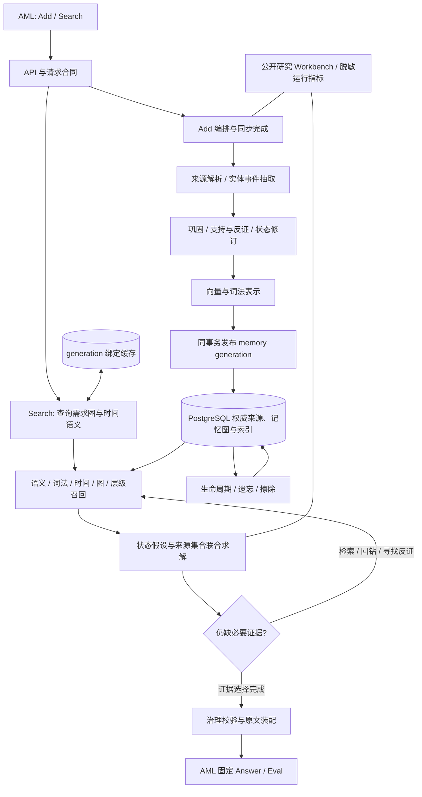
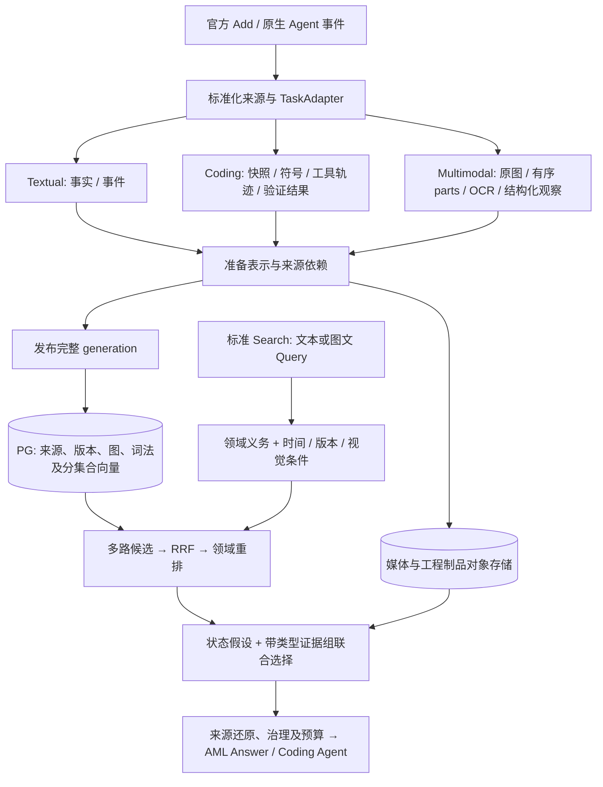

# EviEpoch 参赛系统技术设计

**版本：** 1.1 目标设计，新增 Coding / Multimodal 扩展

**日期：** 2026-11-02，Asia/Shanghai

**产品合同：** [PRD](PRD.md)
**依据：** [AML 官方协议与评测说明](https://agentmemories.ai) · [综述研究议程](../literature/survey-agenda.md) · [系统启发](../literature/systems/eviepoch-implications.md) · [Coding / Multimodal 源码审阅](CODING_MULTIMODAL_SOURCE_REVIEW.md)

**实现进展：** 本文保留完整目标设计；当前分层代码、实际验收与未完成项见 [IMPLEMENTATION_STATUS](IMPLEMENTATION_STATUS.md)。开发验证按用户要求暂用 DeepSeek，正式模型合同不变。

本文定义拟实现的完整参赛架构。SQLite 是显式本地验证适配器；标准生产 Compose 使用 PostgreSQL/pgvector。本文的容量与 SLA 目标仍需在目标硬件和真实数据库上验收，不代表已经达到。

§1–§17 是共享记忆核心的目标合同；§18–§23 将其扩展为 Textual、Coding、Multimodal 三种任务适配器。Coding 的目标是按仓库版本复用工程经验并抵抗干扰历史；Multimodal 的目标是联合使用原始图像、结构化视觉观察与文本证据。两种扩展共享 namespace、generation、来源依赖和治理机制，分别拥有领域类型、索引身份、查询义务和评测配置。新增章节描述待实现能力，当前代码状态与源码依据列在 §18.1 及配套审阅文档。

## 1. 技术主张

采用统一来源与记忆生命周期底座，在同一个查询求解过程中联合决定：

1. 需要使用哪些实体、事实版本、事件、原因、规则与例外；
2. 哪些状态假设在问题所指时间和来源条件下成立；
3. 哪组原始证据能完整支撑这些假设，或展示尚未解决的分歧；
4. 在上下文、延迟和披露边界内，接下来最有价值的取证操作是什么。

写入侧执行有证据校验的分层巩固与可信修订，治理侧对选择性遗忘、失效、抑制和擦除使用不同语义。核心不是增加一个图数据库，而是让记忆对象、管理动作与查询效用具有可执行合同。

所有生成式解析/抽取/反思/规划使用 gpt-4o-mini，检索 embedding 使用 text-embedding-v4。独立 cross-encoder reranker 仅输出相关性/覆盖分数和候选 ID；训练数据来自公开或自建训练分区，不使用正式评测私有内容。

## 2. 系统架构



### 2.1 组件选型

| 组件 | 选型/职责 |
|---|---|
| HTTP 服务 | FastAPI；正式接口与现有公开路径映射保持合同一致 |
| 编排器 | 异步 I/O + 有界计算 worker，Add 请求一直等待最终提交；worker 不是提前成功的后台写入 |
| 权威数据 | PostgreSQL；来源、断言、事件、图、状态版本、治理、幂等账本 |
| 向量索引 | pgvector；精确与 HNSW 检索按工作负载配置，向量与来源处于同一事务域 |
| 词法索引 | user 作用域内 postings/document-frequency/BM25；多语言 tokenizer 版本固化 |
| 图/时间访问 | 关系边表、邻接索引、时间范围索引、递归/受预算图遍历；与来源共享 ID |
| 临时缓存 | Redis；只存可重建的 generation 绑定结果/计算缓存，不是权威事实 |
| Reranker | 独立批量评分服务；公开训练、固定模型与配置 |
| 归档与备份 | 加密对象存储/数据库备份；全部对象有来源与删除依赖记录 |
| 观测 | OpenTelemetry 与指标面板；公开研究可留完整 trace，正式私有运行仅必要脱敏元数据 |

图、向量、时间与状态共用 PostgreSQL 是事务与数据组织选择，已有 Cognee/Hindsight 先例。它不被单独作为原创贡献。

## 3. 数据模型与不变量

### 3.1 权威对象

所有主键/外键均包含 namespace_id；namespace 对应外部原样 user_id，内部映射使用不可逆 ID。session_id 只组织来源，不缩小 Search 的用户范围。

| 对象 | 核心字段 | 语义 |
|---|---|---|
| Namespace | id, external_user_id, committed_generation, policy_generation | 隔离边界与可见版本 |
| IngestRequest | namespace, request_id, payload_hash, status, lease, committed_generation | 幂等和处理进度；PENDING 不对 Search 可见 |
| SourceMessage | source_id, request/session, ordinal, role, original_content, source_timestamp, stored_at, hash | 权威字符串或有序图文原件，普通更新不改写；图文目标模型见 §20–§21 |
| SourceSpan | span_id, source_id, part_ordinal, UTF-8 byte_start/end, text_hash | 精确文字来源；偏移属于对应 text part；现有字符串视为 part 0 |
| Entity/Mention | canonical_id, alias, type, mention_span, identity_confidence | 名称与同一性分开，保留同名分歧 |
| Assertion | subject, predicate, object/value, modality, cardinality, provenance, confidence | 一项可支持/反驳的陈述，不自动等于客观真值 |
| Event | event_type, participants, time_bounds, location, sources | 已发生/计划/假设事件分型 |
| Relation | from, to, type, support_spans, derivation, confidence, generation | 支持、反对、纠正、替代、时序、因果和规则依赖 |
| Summary/Scenario | scope, content, source_set, coverage_map, valid_scope, validation_state | 可回钻的情景/实体归纳 |
| Reflection/Procedure | hypothesis, applicability, premises, steps, exceptions, support/counterexamples | 经验与程序，区别于原始事实 |
| RetentionPolicy | target, action, effective_generation, source, state | 降活跃度、抑制或擦除 |
| Embedding/LexicalPosting | object_id, representation_version, vector/terms, namespace | 检索派生表示 |
| MemoryOperation | op_id, type, inputs, source_refs, before/after_refs, model/prompt/config, generation | 操作溯源；普通操作日志不复制私有正文 |

LLM 输出源句和消息序号，确定性代码再定位源片段并核验 hash；不信任模型直接生成的字符偏移。找不到来源的抽取项不能发布为已支持事实。

### 3.2 必须成立的不变量

- 任何输出内容都能定位到当前允许披露的 SourceMessage/SourceSpan。
- 任何派生对象都能沿依赖图追到原始来源，并在来源撤销后失效。
- 相同 request_id、相同 payload 只产生一次逻辑写入；不同 payload 不静默复用。
- Add 成功后，其来源、基础表示、声明的管理变化和治理状态在同一 generation 可见。
- 每次 Search 在一个已提交知识快照上求解；不使用未提交或该增量节点之后的数据。
- 历史失效不等于物理删除；治理禁止披露优先于历史查询。
- score 是检索相关性，不表示事实真值概率。
- Query/options/Agent 假设不是 Add 来源，不生成新的用户事实。
- 语义、词法统计、图扩散和缓存均不越过 namespace。

数据库行级策略与应用查询双重携带 namespace；服务角色不是 owner/superuser，不带 BYPASSRLS。连接池按事务设置作用域，不能依赖上一请求的会话变量。

## 4. 时间与事实状态

### 4.1 时间不是一个 created_at

每个断言/事件记录：

- asserted_at：来源陈述的时间；缺失时保留未知；
- stored_at / known_from_generation：系统何时记录并发布它；
- occurrence_time：事件何时发生；
- valid_time：属性/规则何时适用；
- precision 与 earliest/latest bounds：年/月/日/区间/不确定边界；
- anchor_span 与 derivation：相对日期如何由来源时间归一化。

使用半开区间 [start,end) 的精确值时，必须有足够证据；未知边界不是一个捏造的精确时间。计划/愿望/条件句不能覆盖已发生状态，晚写入的旧历史不能成为最新有效事实。

检索索引分别保存 valid、occurrence、mention、asserted 与 stored 时间；Source/Span 正文里的日期只进入 mention 索引，不能填入事实 valid_time。as-of 有效性查询按完整区间重叠条件检索（valid_start 不晚于查询上界，valid_end 为空或不早于查询下界）；相对事件比较即使没有 as_of 锚点，也会用词法候选召回带 occurrence_time 的对象。asserted_at 与 stored_at 分别表示来源陈述和系统记录时间，不作为 occurrence_time 的替代。旧 SQLite/PG 索引迁移会清除历史 Source/Span 上误用的 valid_start，并回填各自时间列。时间范围端点按闭区间日粒度比较，测试覆盖有效结束日期之后的排除与未来结束日期之前的保留，避免把未来失效误判为已过期。

“现在”优先采用题内明确时间；否则绑定当前 user 已提交来源陈述所定义的时间视野，未来计划中的日期不扩大“当前”时点，不能用服务器今天日期随意解释历史样本。无法确定相对锚点时保留多个时间假设，由查询求解器联合取证。

### 4.2 状态与关系

- SUPPORTS：等值或相容证据，按独立来源计支持，重复转述不重复强化。
- SUPERSEDES：真实状态变化，旧事实仍可能在过去有效。
- CORRECTS：之前的陈述被纠正，可能追溯改变对旧陈述的判断。
- CONTRADICTS：同主体/同属性/重叠适用范围中存在不相容说法，尚不能当成变化。
- RETRACTS：源陈述被撤回。
- SUPPRESSES / ERASES：治理动作，与事实真值正交。

多值属性（兴趣、技能、多个联系人）不因出现新值就失效旧值；单值属性也需匹配情景和有效时间后才判冲突。状态保存在版本化投影与证据边上，而非改写原始文本。

### 4.3 查询条件化状态求解

对一个问题保留状态假设集合 H(q)，例如“2022 地址 X”“2024 后地址 Y”“源时间不明的替代说法”。当前、as-of、history、comparison、order、why 问题对同一组事实提出不同约束。

状态置信度结合来源直接性、实体一致性、时间可信度、独立支持和反证。权重在公开开发数据校准；LLM 自报数字不直接视为校准概率。用户自述在用户偏好/个人信息上比 Agent 推断更直接，外部规则/工具事实则按对应来源权威性处理，不能简单按 role 一刀切。

投影和取证循环相互反馈：候选状态决定需要什么证据；新来源可能推翻状态假设。不能先 latest-wins 决定唯一结果，再给它补证据。

## 5. 分层巩固

### 5.1 层级与双缓冲

| 层级 | 内容 | 检索用途 |
|---|---|---|
| L0 | 精确源消息/片段 | 事实核验、完整原文支持 |
| L1 | 实体、断言、事件和关系 | 精确属性/时间/路径查找 |
| L2 | 事件簇、会话情景、实体观察 | 场景恢复与全局导航 |
| L3 | 稳定偏好、受验证经验/规则/程序 | 复用约束与跨经历模式 |

新派生记忆先进入 hot 状态；校验来源、消歧、时间、重复和重要性后晋升。hot 与长期层都可检索，晋升不造成 Add 后不可见。原始来源保留与活跃索引选择分开：长期归档可通过精确源 ID、实体/时间和向量索引重新激活。

重要性评估采用当前可观察的显式承诺/约束、关键性、独特信息、跨经历支持、任务复用和冗余度，不使用未来问题或评测金标。罕见的否定、数字、日期、例外、安全关键事实有独立保护标记，不能被“访问少”逐出全部访问路径。

### 5.2 巩固合同

每次合并产生 Summary/Scenario 与 source coverage map，包含保留的主体、数值、时间、否定、例外和来源集合；新摘要不是新事实。质量检查包括源支持与关键信息保真。原始事实的冲突不能在摘要中无痕变成单一肯定陈述。

触发由新信息量、重复度、状态冲突、活跃工作集大小和空闲调度共同决定。后台重组只发布新的完整投影 generation；语义/治理变化不能以未版本化缓存覆盖。有限 hot 空间的处理是将完整来源转入可查询长期存储并释放重复派生缓存，不静默丢弃来源。

## 6. 可信反思、原因与程序

### 6.1 反思对象

反思状态为 hypothesis / supported / challenged / revised / retired。每条含适用范围、支持源、反例、独立证据计数和有效时间。observation 是来源归纳；reflection 是超出单条来源的经验判断，类型不同。

反思流程：从 Add 证据形成候选 → 检索独立支持及反例 → 检查适用域 → 校准置信度 → 发布带依赖的经验。新的反例可拆分适用条件或修订结论。没有新证据的重复检索不增加事实可信度。

Search 内部为取证生成的临时假设只服务当前问题；不把假设/选项/答案持久化为自述事实。公开实验可以对反思使用外部标注验证；正式评测数据不进入训练/离线产品分析。

### 6.2 因果边与程序图

关系类型区分 CAUSE_STATED、CAUSE_HYPOTHESIZED、BEFORE、ENABLES、REQUIRES、EXCEPT_IF、RULE_VERSION、RESULT_OF。时间先后和语义共现不直接升级为因果。

程序对象保存前提、步骤、例外、结果证据与适用情景。问题需要“如何执行/适用何规则”时，生成包含规则版本、相关事实、条件、例外和顺序的证据义务图。服务不替固定 Answer 生成执行结果。

图的节点与边均有来源；边扩散记录路径和每步支持。时间约束的矛盾/环进入待取证状态，不强行拓扑排序制造确定顺序。

## 7. 同步 Add 事务与并发

### 7.1 处理过程

1. 验证请求，按原样标识计算 namespace 与规范化 payload hash；hash 覆盖合同中的三个 ID 及有序消息的 role/content/timestamp，明确 absent/null 规范，不对正文做 strip 或 Unicode 改写。
2. 在幂等账本注册 PENDING/lease。相同 hash 已 COMMITTED 返回原成功标识；正在处理则合并等待或返回可重试状态；不同 hash 返回明确冲突错误。
3. 从已提交知识视图取必要实体/属性上下文。gpt-4o-mini 批量抽取 facts/events/preferences/procedures/governance，并对来源 quote、模态和时间做结构校验。
4. 对受影响实体/属性生成支持、更新、纠正、冲突、反例与巩固操作；生成所需索引表示。大模型调用在最终数据库事务之外，避免长时间持锁。
5. 最终事务检查依赖对象版本。若基准 generation 已变化，仅重算受影响的协调结果；保留原始消息，不以并发到达顺序当事件发生顺序。
6. 原子发布来源、所有在线索引/关系/状态/治理、幂等 COMMITTED 和新的 committed_generation。
7. 成功后响应原始 request/user/session ID。Redis 缓存不参与成功判定；缓存按 generation 读穿权威存储。

正式 Add 使用同步 200 合同。数据库作业状态可供内部恢复，但不将未完成工作当成功。关键模型阶段失败保留可恢复处理状态并返回明确错误，不把完整 profile 静默换成 raw-only。

### 7.2 并发一致性

同 request 使用租约/唯一约束；相同实体属性使用版本检查与最终事务协调，跨实体抽取可并行。Search 在读取已提交 generation 后使用同一快照，保证一次请求内部来源、状态与政策一致。

Streaming 的新 Add 或治理变化都会递增 generation；Query cache key 包含 namespace、generation、policy_generation、query/options hash、模型/prompt/配置版本。相同问题在新节点不能命中旧知识缓存。

## 8. Search：需求图、候选与联合求解

### 8.1 查询中间表示

QueryPlan 至少包含：

    {
      "intent": ["current", "as_of", "history", "order", "why", "procedure", "list", "global"],
      "entities": [],
      "attributes": [],
      "time_constraints": [],
      "evidence_obligations": [],
      "alternative_hypotheses": [],
      "required_relations": [],
      "privacy_scope": {},
      "search_actions": []
    }

原始 query 始终保留；改写用于补充查询，不替代原题。options 仅作为待核查主题/假设，不能当成真实事件或答案标签。所有控制动作输出结构化工具调用/ID，不能把规划文本塞进来源证据。

### 8.2 并行候选通道

| 通道 | 数据与信号 | 作用 |
|---|---|---|
| Dense | 原始片段、事件、事实、情景/摘要 | 同义改写与跨表达召回 |
| Lexical | 人名、数字、专有词、规则编号、多语言词项 | 精确标识和长尾内容 |
| Temporal | occurrence/valid time、区间、阶段和版本 | 时间约束内相关事实与覆盖 |
| Entity/Relation | 实体同一性、支持/反证、原因/规则路径 | 远距离与多跳依赖 |
| Hierarchy | L2/L3 导航回钻 L1/L0 | 长历史概览与范围缩小 |
| Counter-evidence | 与当前假设不相容的来源、旧版本/纠错 | 发现错误状态和确认偏误 |

初始用 RRF 或校准融合统一候选，再用 cross-encoder 估计 query/obligation/候选的关系。词法统计按 user 计算；Postgres 原生 tsvector rank 不冒充 BM25，全局 IDF 不能让其他样本数据影响本用户排名。

图扩散从实体/语义/时间锚点启动，按边类型和证据质量传播。图有界稀疏，不生成所有事件两两时间边；历史顺序和范围由时间索引支持。访问过的 source/span 去重，不因看过一个 session 就永久跳过整个 session。

Entity/Relation 图召回是独立 RRF 检索臂，在 Top-N 截断前按 QueryPlan 实体、属性查实体提及倒排索引，再沿显式 entity ID、无 ID 的精确同名实体以及已持久化关系边进行有界多跳。精确同名只产生候选关联，不写入新的事实边；有明确但不一致的 ID 时不靠同名跨越。图候选继续经过统一 rerank、proof binding、来源治理和 Disclosure；图路径不替代原始来源证明。其预算受 graph_budget、graph_depth 限制，并通过 RRF 与 Dense/BM25/Temporal 合流。

时间候选按 valid、occurrence、正文日期 mention、asserted 和 stored 分通道召回。对 “多久之后 / after / between” 一类相对事件关系，即使 QueryPlan 没有 as_of，也会启动 occurrence 通道；该通道先在词法候选中挑带事件时间的对象，因此时间索引是补充召回，而非全库时间扫描或硬过滤器。

当前 Search 的 cross-encoder 链路按以下阶段执行：

1. Dense、user-BM25/lexical、Temporal 与实体提及图通道先做 seed RRF，再执行 Top-N 截断；从保留 seed 扩图后，把新发现的显式关系候选作为独立 relation RRF 通道重新融合。
2. 从融合快照形成有界 rerank 池。池内按 RRF/来源、时间、规则边（REQUIRES、EXCEPT_IF、RULE_VERSION）和反证/修订边（CONTRADICTS、CORRECTS、RETRACTS、SUPERSEDES）保留类别配额，再按融合分数补足。
3. 独立 Qwen3-Reranker-0.6B sidecar 对候选批量打分。长来源在调用端切为有界片段；服务按小批次推理、串行限制 GPU/CPU 并发，并设置服务端排队上限。HTTP 调用有独立超时；无效响应、过载、模型未就绪或超时都记录降级并继续使用融合分数。
4. Rerank 之后执行 State Projection 与 Evidence Proof。成功的 cross-encoder 分数直接替换已评分来源的最终 Evidence Score；Proof Alternatives 使用同一分数的单调归一值参与启发式排序，Beam 使用来源 Evidence Score，之后不再用旧 fused 分数覆盖。超长来源最多保留三个互不重叠片段；规则/程序来源优先保留前提和例外，并把精确来源范围与段落位置带到输出。
5. rerank 池只控制首次评分，不从快照删除未评分来源。Proof 绑定返回池外来源、局部 Proof 发现池外候选，或缺口搜索召回新来源时，执行一次额外的有界评分并重建 Proof。这样模型不会把一次候选截断变成不可逆过滤。
6. Disclosure 在选中的原文片段上验证相关性与披露边界；AML Search evidence 只装配通过验证的来源内容、范围和段落 metadata。

实际部署变量、配额及分段默认值见 [.env.example](../.env.example)；reranker sidecar 的部署与降级行为见 [IMPLEMENTATION_STATUS](IMPLEMENTATION_STATUS.md)。

### 8.3 联合优化目标

令 S 为返回的源证据集合，H 为问题下的状态/依赖假设，U 为必要证据义务：

    maximize J(S,H)
      = sum_u w_u * coverage(u, S, H)
        + alpha * relevance(S,q)
        + beta * temporal_and_source_consistency(S,H)
        + gamma * verified_dependency_support(S,H)
        - lambda * redundancy(S)
        - mu * token_cost(S)

约束：

- S 中每项存在允许披露的源片段；
- 数量 ≤ top_k，序列化后的总成本 ≤ 实际 Answer 证据预算；
- 状态/因果/程序结论要有完整来源路径；
- 真实未解冲突以替代假设与相应来源表达，不能为了提高一致性分数把反证丢掉；
- 已禁止披露内容不进入 S，即使问题指向历史时间。

coverage 使用 AND/OR 需求图：换工作与搬家的顺序至少需要两个时间前提；存在多套充分证据时允许任意一套，而非只有一组固定 gold ID。

实现采用 beam search over hypothesis/proof states + 按边际覆盖增益/成本的证据扩展，保留替代状态。选择器可对候选状态和来源包交换/补齐；所有结果回到源 span。该选择器是研究主张核心，需要与“相同候选 + 独立 Top-K”和“相同预算 + greedy cover”比较。

### 8.4 取证控制循环

控制器执行 PLAN、SEARCH、TRAVERSE、PROJECT_TIME、FIND_COUNTEREVIDENCE、DRILL_DOWN、SELECT、FINISH。每次动作带未满足义务与可检查依据。

终止条件为证据义务满足、现有来源确实不足，或按 query class 声明的调用/token/延迟预算耗尽。预算控制用于统一实验与服务调度，完整功能不会因未实现而用其他 profile 冒充。结束时只装配已有证据，不填造缺口。

## 9. 证据装配与外部接口

公开 Add 请求、响应与 Search 字段遵循 [AML 当前官方合同](https://agentmemories.ai)。服务本地路由可继续 /add、/search，网关把提交路径映射到它们。Textual/Coding 的 content/query 使用字符串；Multimodal 的有序图文请求与响应见 §20。

### 9.1 证据单元

以写入时确定的源消息/片段为稳定单位，ID 由 namespace + request + ordinal + part/span/version 稳定导出。多来源证据包使用有序 atom IDs 与 packer 版本生成可复现的 bundle ID，并保存完整映射；临时生成的无来源段落不能成为记忆对象。

Textual/Coding 的 content 只含原始语言的源文本与确定性的真实来源标记（时间/role、可核验版本与位置）。Multimodal 另外交付原始图片或带父图/transform 的允许区域，来源依赖与披露条件保持一致。生成 caption、OCR 和 applicability 推断参与内部索引、导航与核验，不能伪装成原始源句；图片证据的合同见 §20.2、§20.6–§20.8。不输出“所以答案是 Y”、未经来源验证的摘要、生成式状态说明或诱导 Answer 的指令。内部 metadata 不被视作平台会读取的字段。

返回以证据对查询的边际贡献和依赖组组织，组内可按时间排列；不在最后执行无条件 raw-first 重排破坏已计算顺序。所有返回项都是来源证据，派生事实仅参与索引。

### 9.2 响应示例

    {
      "data": [
        {
          "id": "src_opaque_stable_id",
          "content": "[2024-06-12T09:00:00Z][user] I moved to Shenzhen in May.",
          "score": 0.92,
          "created_at": "2024-06-12T09:00:00Z"
        }
      ]
    }

top_k 是最大条数，不强制填满。score 如返回，须与最终排序语义一致；created_at 使用可核验的来源时间，缺失时不补造。无结果返回 data=[]。

实际预算包含 query/options、平台包裹文本、每项标记与源文字；本地现有 117760 是 runner 配置，不能当成官网保证的 Answer 输入上限。冻结时将实际合同预算和 tokenizer 写入 manifest。

### 9.3 错误语义

格式/空正文为 400/422，鉴权失败为 401；in-flight 请求冲突与临时容量状态明确区分。429/503 携带合理 Retry-After。相同 ID 的重试不得重复计数或发布部分数据。服务 deadline、反向代理、模型调用与官方请求上限组成一致的链路超时配置。

## 10. 遗忘与治理的执行

### 10.1 四类操作

| 操作 | 在线效果 | 来源处理 |
|---|---|---|
| Deactivate | 减少活跃工作集，可被适当查询重新激活 | 仍可恢复，不宣称删除 |
| Invalidate/Supersede | 限制某事实/规则的适用区间 | 历史来源保留 |
| Suppress | 对指定范围禁止检索/披露 | 立即影响所有来源装配 |
| Erase | 删除在线原文和派生对象，追踪备份擦除完成 | 仅保留不含内容的治理凭据 |

忘记指令通过 Add 的来源处理，不要求平台发送额外 delete 字段。target 包括主体/属性/来源范围、截至何 generation 和是否持续禁止存储；模糊目标不擅自扩大到全部用户数据。

### 10.2 派生链清理

通过来源依赖闭包定位 raw spans、facts、events、summary、reflection、relations、postings、vectors 和 cache。受污染摘要重新生成或失效；包含被禁止值的删除指令自身也不得通过返回原文泄漏目标。

在线发布 tombstone 与清理在 Add 成功前生效；历史请求重试、缓存、索引重建和备份恢复必须应用最新治理账本。备份副本有独立清理任务与完成记录，未完成不记为“全副本物理擦除完成”。

正式运行数据按赛事保留期限清理，包括 jobs/staging、模型缓存、备份和调试副本；公有研究集与私有运行空间物理/逻辑分开。

## 11. 存储、索引与规模

namespace hash 分片；实体/事实/图关系和 postings 索引前缀包含 namespace。大用户分区/索引与普通用户分桶的策略在 manifest 中固定，不按 benchmark 名称或 user_id 内部字符串猜测数据集。

向量查询在用户范围内返回足够候选；ANN 的后置过滤不能导致跨用户候选先占满池。使用分区/过滤感知扫描和候选补足，并用精确检索对照测 ANN recall。写入增量向量在权威索引提交后即可访问，不依赖未完成的外部索引刷新。

容量以实际对象数估计，而不是把 300M tokens 当 300M memory：
- 设 M 为向量对象数，d 为实际维度，float32 payload 为 4Md bytes；
- 图边按稀疏邻接度统计，不做 O(M²) 全连接；
- 记录原文、派生文本、postings、向量、图、WAL、缓存、备份的实际放大率；
- 使用普通/长尾/单大用户/Streaming/并发混合工作负载测 p50/p95/p99 和完成总时长。

数据源默认向量维度可沿用 1024，但模型、维度、预处理、tokenizer、ANN 和融合配置一起版本化；更改后重建对应索引，不混用旧向量。

## 12. 控制器、调度与成本

一个控制协议覆盖任务类型，不为公开 benchmark 名称特制规则。调度器分别管理 embedding、gpt-4o-mini、reranker 和数据库容量，按 RPM/TPM/GPU batch/数据库资源约束调度同步请求。

预算按任务复杂度分配，但每次调用、输入输出 tokens、候选数和图激活量可归因。全量成本模型采用真实 Add chunk 数、每 chunk 抽取/协调调用、原文/派生 embedding tokens，以及 Streaming 实际 Search 次数；不把 6000 实例直接等同 6000 Search，不以固定 token-to-word 系数推算官方切分。

Search 的收益成本由同条件实验评估；更新策略也报告总 Add 工时和模型调用。高吞吐并发通过分片和批处理获得，不能以提前返回成功隐藏工作量。

## 13. 研究评测设计

### 13.1 数据与协议

公开研究使用 conversation/user 隔离的 train/dev/sealed-test；同源模板、同一人的会话和派生变体不跨分区泄漏。结合 LoCoMo、LongMemEval、MemoryAgentBench 的公开合法部分、偏好/规则任务与综述衍生控制场景。

Answer 模型、prompt、judge、token/调用预算、数据切片和种子固化。若未取得与正式平台一致的 pipeline hash，本地结果标为代理评测，不称官方 Overall。正式私有输入只完成评测，不进入本地重建集、训练或事后内容分析。

证据标注支持多套充分集合/等价源与 AND/OR 依赖，不要求只有唯一 gold_ids。没有证据应拒答与必须披露某证据分别标注，避免“空结果提高隐私分”掩盖召回失败。

### 13.2 强基线

| ID | 基线 |
|---|---|
| B0 | 当前 EviEpoch commit 的双通道向量 runner |
| B1 | 原文 Dense + user-BM25 + session-RRF + 邻域扩展 |
| B2 | 允许模型配置下的 TEMPR 风格多路/图/时间检索 |
| B3 | 同固定 Answer、同预算的上下文基线，明确截断/全量条件 |
| B4 | latest-wins / hard-overwrite / append-only 时间策略对照 |
| FULL | 完整管理、联合状态/依赖与来源集合选择 |

不能用论文中的 GPT-OSS/Gemini/Claude 成绩代替这些匹配基线。

### 13.3 支撑主张的消融

| 研究问题 | 必要实验 | 观察 |
|---|---|---|
| 巩固不丢失 | 无巩固 / 破坏性摘要 / 完整可回钻巩固；去关键事实保护 | 关键/长尾事实存活、来源完整、活跃空间与成本 |
| 因果取证 | 去因果边 / 打乱边 / 只时间邻域 / 完整因果支持 | 语义远距离原因、链方向、路径支持率 |
| 可信反思 | 无反思 / 只正向强化 / 源验证 / 反证驱动 | 错误传播、修正率、外域泛化 |
| 安全遗忘 | TTL / 主表删除 / 完整依赖闭包 | 泄漏、复活、无关信息误删 |
| 状态与集合联合 | 独立 Top-K / 先定状态 / greedy cover / 联合求解 | Current+Historical、完整前提、最终答案 |
| 跨能力效用 | 去规则/例外层、去场景偏好、去缺口迭代 | A/B/C/D/E/G/H 的效果分布 |

四个主要机制做 2×2×2×2 交互实验，避免把交互增益归到单一组件。选择器对照固定相同候选；召回对照固定集合选择器；同时报告等 token/调用预算与完整运行成本。

### 13.4 指标

- 任务：固定 Answer 正确率、公开数据集标准指标、每能力切片及配对置信区间。
- 记忆：等价证据 Recall、Complete Evidence Rate、因果/规则路径支持、Current/As-of 正确、罕见事实保真、错误 supersession、反思修订。
- 效率：Add/Search 分阶段延迟、p95/p99、总完成时长、tokens/调用、索引放大与缓存。
- 治理：cross-user leakage、suppression/erase 漏洞、重放复活、错误删除、源引用有效性。

## 14. 可观测性与运行

公开研究 Workbench 按一次交互呈现“来源 → 抽取 → 管理 diff → 需求图 → 候选路径 → 选中源 → 固定 Answer”，并能定位写入、巩固、召回、状态推断、集合遗漏与 Answer 推理的责任。

正式私有运行关闭正文/推理内容调试日志，仅记录必要计数、耗时、错误、版本、不可读标识与官方允许的复核信息。源内容留在完成任务所需的受控记忆存储中，不复制到监控/分析服务。

部署采用独立运行的计算与持久数据库，统一 HTTPS 网关、健康/就绪探针和版本指标。现有 ECS 转发 + 桌面宿主是已记录基线拓扑；目标发布使用固定镜像与持久服务拓扑，资源和 provider 配额由 PRD 工作负载定义。

数据库备份、恢复和 schema/index 迁移都有 namespace/generation/治理账本校验。恢复不能回滚删除政策或把新版向量误配旧模型。重试恢复必须沿用相同 request_id 与 payload。

## 15. 代码组织与当前迁移

建议目标模块：

    eviepoch/
      api/                 # 官方合同、鉴权与请求生命周期
      adapters/            # Textual / Coding / Multimodal 领域合同与输入输出
      domain/              # 来源、实体、时间、断言、程序和治理类型
      ingest/              # 抽取、源片段核验、幂等编排
      manage/              # 巩固、反思、状态投影与反证修订
      retrieval/           # query plan、多路候选、图激活、联合选择
      governance/          # suppression、erase、保留与派生闭包
      storage/             # PostgreSQL/pgvector/postings、版本与事务
      providers/           # 固定模型、reranker、调用计量
      observability/
    experiments/
      datasets/            # 清单/哈希/适配器，私有数据不入库
      evaluate/
      ablations/
      reports/
    workbench/

旧 SQLite 数据迁移到独立候选数据库，保留旧 ID 映射、request ledger、源时间与 embedding identity。现存展示字符串无法证明原始 payload 字节完全一致时，标记为 legacy_source；从合法原始输入重新导入的研究运行可得到精确源。公开旧版本保持可复现，新的发布版本独立绑定 commit/镜像/schema。

本次工作只写设计与研究材料，不把此目录结构描述为已完成代码。

## 16. 验收与冻结产物

实现验收覆盖接口和状态不变量、时间/因果/程序语义、巩固保真、反思修订、遗忘闭包、Streaming/并发一致性、统一端到端质量与真实模型公网容量。

正式 release manifest 至少包括：
- git commit、镜像 digest、schema/索引/迁移版本；
- embedding/LLM/reranker 名称与实际 provider、维度、预处理、prompt hash；
- 控制预算、融合/集合优化参数、tokenizer、source rendering 版本；
- 公开研究 data manifest、split、pipeline hash、基线与消融配置；
- 部署端点/鉴权方案/资源/实际并发声明、容量报告与 Smoke ID；
- 上游仓库/作者/commit、许可和修改说明；
- Full Run/Suite/Pipeline/数据版本标识及受控保留/删除记录。

截止与 Full 次数按 [AML 官方赛事说明](https://agentmemories.ai) 及实际获批评测版本执行。运行 Full 前冻结实际部署版本和方法配置，评测进程不接收人工修改记忆或调换算法。


## 17. PRD 需求追踪

| PRD 需求 | 本设计章节 | 验收资产 |
|---|---|---|
| F01–F02 来源/可追溯抽取 | §3、§7、§9 | 源片段校验、引用完整率、原文 round-trip |
| F03–F05 实体/时间/状态 | §3–§4 | 同名/多值、历史/当前、变化/纠正/计划场景 |
| F06 巩固 | §5 | 关键事实保真与活跃空间对照 |
| F07 可信反思 | §6 | 支持/反例、适用域、纠错与传播实验 |
| F08 遗忘 | §10 | 全派生闭包、缓存/重放/备份恢复验证 |
| F09–F11 查询与联合取证 | §8 | 需求图、路径支持、等预算选择器消融 |
| F12 证据交付 | §9 | API、排序、条数、序列化 token 和 source ID |
| F13 Streaming | §7、§10 | generation 可见性、更新/删除后的重复查询 |
| F14 隔离/证据边界 | §3、§8–§10 | 跨 user、选项假前提、无答案和敏感范围场景 |
| F15 Workbench | §14 | 公开样本的完整操作与证据 diff |
| F16 容量 | §11–§12、§14 | 真实 provider/公网混合负载报告 |
| F17 可复现 | §13、§16 | manifest、pipeline/data hash、许可与版本绑定 |


## 18. 三赛道共享核心与扩展边界

### 18.1 当前代码起点

本次设计基于 2026-11-02 的本地工作区，HEAD 为 `2bf80f51fb3e5ebe1022dbc7291d18f84b56e053`，含正在修改的运行与审计代码；关键文件哈希保存在[源码审阅](CODING_MULTIMODAL_SOURCE_REVIEW.md)。现有实验不能自动代表以下扩展的结果。

| 当前代码 | 可复用的实际能力 | 扩展需要完成的变化 |
|---|---|---|
| `api/app.py`、`domain/requests.py` | 标准 Add/Search、user 隔离、字符串消息和查询 | 有序 ContentPart 类型、图文请求校验、task adapter 路由 |
| `domain/models.py` | Source、UTF-8 Span、Node、Edge、多时间字段、schema v4 | 分 part 来源定位、RepositorySnapshot、工程事件、MediaAsset、Region、带类型的证据原子 |
| `pipeline.py`、`storage/repository.py` | 抽取核验、独立 passage 索引、巩固预计算、generation 冲突重试和原子发布 | 领域 Add 编排、媒体持久化屏障、表示版本与完整性清单 |
| `storage/view.py`、`retrieval/engine.py` | Dense/BM25/时间/实体图候选、RRF、重排、证明绑定和缺口取证 | 代码路径/符号/版本候选、图文 Query、视觉候选、领域证据义务 |
| `retrieval/selection.py`、`evidence.py` | 来源证明组、预算内集合选择、精确文本 span 打包 | 混合证据原子、代码兼容状态、图片完整性、多维预算和前提依赖 |
| `governance/lifecycle.py` | 在线来源及派生对象的抑制/擦除 | 媒体、裁剪、OCR、代码快照、表示及其缓存的依赖闭包 |
| `providers/client.py`、`api/audit.py` | 字符串模型输入、provider 调用与可选正文审计 | 图文 provider adapter、媒体大小统计、无 Base64 正文的诊断路径 |

当前 Salience 仍主要是保护标记；Consolidation 是可回钻的抽取式导航；Reflection 是显式经验的支持/反例更新；Beam 是证据集合选择。这些是扩展的起点。§19–§21 给出领域 salience、经验修订和状态/证据联合求解的目标实现，不能把现有开关视为已经实现这些目标。

### 18.2 共享抽象与领域职责

`TaskAdapter` 是领域扩展接口，配置为 `textual | coding | multimodal`；它与现有 `full/hybrid/b0` 检索配置及 `competition/research` 模型政策分别记录。官方请求没有必填 track 字段，因此适配器由部署版本绑定；标准请求不增加 repository、commit 或本机文件路径等必填参数。

    TaskAdapter.normalize_add(payload) -> OrderedSourceBundle
    TaskAdapter.prepare_write(bundle, committed_view) -> PreparedPublication
    TaskAdapter.plan(query_bundle, options, committed_view) -> QueryPlan
    TaskAdapter.candidate_channels(plan, committed_view) -> RankedChannels
    TaskAdapter.evidence_atoms(candidates, committed_view) -> EvidenceAtoms
    SharedSolver.select(plan, hypotheses, atoms, budgets) -> EvidenceBundles
    TaskAdapter.pack(bundles, policy_snapshot) -> StandardSearchResponse

这些是目标接口，不是当前已经存在的方法。归一化输出保留原消息、part 顺序、role、时间和来源身份；派生抽取不能替换这些内容。适配器产生领域对象与候选，核心管理发布、隔离、来源依赖、状态选择、预算与治理。



来源层提供字节、文本和顺序保真；索引、摘要、经验、caption 与视觉特征都是可重建表示。表示可能省略信息，因此必须能回到原始代码、轨迹或图像。跨领域关系也必须有来源，例如截图对应某个 UI 测试步骤，不能仅凭时间邻近写成已验证关联。

## 19. Coding Memory：按版本复用工程经验

### 19.1 目标、参考实现与输入边界

目标覆盖缺陷修复的定位、根因、补丁约束与验证，以及功能增强的需求、接口、实现依赖和测试适配；在四档噪声下保留正确历史、失败教训和适用条件。主参考为 claude-mem `v12.1.1`，补充 causal-memory 的决策/结果表示与 MemoraX 的原生客户端来源、session/turn/repository 绑定。

claude-mem 的 `search → timeline → get_observations` 在原生工具端可由 Agent 多次调用；AML 只有一次 Search 交付时，三个阶段由 EviEpoch 内部完成，最终返回展开后的实际证据。仅返回索引 ID、摘要或“继续调用某工具”会使平台缺少必要内容。

两种输入共享领域模型：

- **AML Add**：从平台提供的字符串消息中识别任务、工具调用、路径、diff、测试输出和显式决策说明，每项关联原始 span；缺失的仓库 SHA、命令退出码或文件内容保留未知。
- **原生开发适配器**：记录客户端原生的 request/turn/tool 事件和可读取的仓库快照，补充工作区 overlay、工具入参/返回、命令执行目录及制品 hash。相同 native ID 在不同客户端下仍分别命名。
- **仓库资料导入**：对用户授权的仓库构建文件与符号索引；它是独立来源流，不能拿运行 EviEpoch 服务的本机仓库状态替代平台任务的仓库状态。

### 19.2 工程数据模型

| 对象 | 必须保存的字段与语义 |
|---|---|
| Repository | namespace、repo_id、可核验 remote/显式项目标识、身份来源；文件夹 basename 不能作为唯一身份 |
| RepositorySnapshot | repo_id、commit_sha、tree_sha、parent_shas、dirty_overlay_hash、submodule/dependency fingerprint、来源；缺失字段为 unknown |
| FileRevision | snapshot_id、相对路径、Git blob/hash、语言、完整内容或来源引用、编码；行号属于该 blob |
| SymbolRevision | snapshot_id、file_revision、语法类型、限定名、signature、byte/line range、body_hash；重命名映射保存核验状态 |
| EngineeringEvent | client/session/turn/tool_call_id、有序输入/输出 span、cwd、before/after snapshot、event_time、stored_generation |
| PatchAttempt | base_snapshot、原始 diff、patch_hash、作用文件/符号、attempt_id、applied_snapshot、是否应用及结果来源 |
| TestRun | command/selector、environment fingerprint、运行时 snapshot/tree/overlay、exit_code、输出 span、测试项结果与执行状态 |
| EngineeringObservation | bugfix/feature/discovery/decision/refactor/change、facts、files_read/modified、相关事件与原始 span；只作导航和经验候选 |
| DecisionOutcome | problem、前提、决策、替代方案、结果极性、失败症状、证据、适用版本/依赖范围、支持与反例 |
| ApplicabilityAssessment | query snapshot、historical attempt、compatible/incompatible/unknown、逐项依据、可迁移部分、缺口；Search 内暂存 |

`snapshot_id = H(namespace, repo_id, commit/tree identity, dirty overlay, identity_version)`。无可核验 SHA 时使用来源限定的 provisional snapshot，不能伪装成一个真实 Git commit。相同 commit 加不同未提交 diff 是两个快照；相同路径在不同 repo 下也是不同对象。

Git 版本按提交 DAG 判断祖先、分叉、合并和回滚，不转换成一个全局时间区间。代码有效范围可以是可验证的 ancestry 条件、blob/symbol 指纹及依赖约束的合取。较晚写入的旧补丁不覆盖当前代码；某分支上的通过结果不自动适用于另一分支。

### 19.3 写入链路与经验治理

1. 固化原始任务、工具入参/返回、文件读取、diff、退出码与测试输出。官方来源若已经是字符串，保持其字节与 span；不重新排版 diff 后再当原始来源。
2. 按事件关联 task、attempt 和 before/after 快照。只有显式 tool_call/turn 关联或可验证制品关系才能建立确定边；时间邻近只产生待核验候选。
3. 对已提供文件构建 tree-sitter 等语法解析、符号、导入和调用候选索引；动态调用关系与静态近似分别标记。没有完整文件时仅索引已经观察到的符号或片段。
4. 使用 claude-mem 的工程观察结构提取变化、发现和显式决策说明，并逐项关联源码/工具输出 span；保留失败尝试和被否定的方案。
5. 构建 `REPRODUCED_BY / MODIFIES / CALLS / DEPENDS_ON / TESTED_ON / VERIFIED_BY / REVERTS / RESULT_OF / EXCEPT_IF` 等带证据边。测试通过必须绑定测试运行的确切 tree/overlay。
6. 生成按 repo、任务、版本范围、规则前提组织的导航摘要与经验对象，再计算所有声明为必需的向量、路径/符号 postings 和依赖关系。
7. 复用 prepare/publish 协议，校验 generation 后一次发布。经验、索引与 TestRun 不出现“事实先可见、验证依据稍后补上”的窗口。

工程 salience 为 `novelty + decision_impact + failure_signal + verified_outcome + reusable_constraint - redundancy` 的可解释组合，参数按公开训练数据冻结。分数只决定观察层组织和活跃派生索引；原始工具证据独立保留。高优先级包括新根因、失败断言、接口契约、版本条件、回滚、环境差异；重复进度播报和记忆工具对自身内容的回读不形成新的经验支持。

巩固必须保留 `problem → attempted change → observed result → verification → applicability`。不同快照、不同环境或成功/失败极性不明的尝试不能压成“方案 X 有效”。同一失败出现多次也要区分独立运行和重复日志。

经验状态为 `proposed / observed / tested / contradicted / superseded`；状态变化由新来源驱动。写着“fixed”的助手消息只能证明有人声称修复；存在匹配快照的成功 TestRun 才能增加验证支持。因果推断保存 `stated / experimentally_supported / hypothesized`，执行顺序不直接产生 `caused` 边。Search 的访问次数和模型确信程度不增加经验真值。

### 19.4 存储与代码表示

权威来源与图仍在 PostgreSQL。新增快照/父边、文件版本、符号版本、事件、patch、test_runs、经验及 applicability 索引；内容较大的文件、diff 和完整测试制品可放对象存储，PG 保存 hash 与依赖。文件路径、限定符号、错误码、测试名、异常栈和依赖版本建立精确/词法访问路径。

文本向量分别编码任务症状、工程观察、决策/结果、函数或补丁片段，各表示拥有独立 ID。跨语言代码向量作为 research 配置；competition 配置使用赛事允许的 embedding。路径与标识符保留原样，并增加拆分后的辅助词法项，不靠英文词形归一化改写真实符号。

符号相似、文件重命名检测和调用图用于发现候选；它们不自动证明两个版本行为等价。相似 patch、相同函数名和相同错误词可以是高干扰负例。

### 19.5 Search：抗噪召回、版本判断与证据恢复

查询解析先确定 bugfix/feature、症状/需求、目标接口、已知 repo/snapshot、语言/依赖、验收条件，再生成义务：复现、根因、实施约束、曾失败方案、有效修复、相关回归测试。只有来源中或当前 query 明确提供的版本条件进入确定过滤。

候选通道并行执行：

| 通道 | 召回内容 |
|---|---|
| Exact / Sparse | 文件路径、符号、异常码、stack frame、测试名、接口与依赖版本 |
| Dense | 症状相近但表述不同的历史任务、观察、patch 与经验 |
| Version | 已知快照的祖先/分叉/回滚、仍存在或已迁移的文件和符号 |
| Graph | 根因到决策、patch、测试、结果、反例及依赖条件的路径 |
| Episode / Timeline | 命中观察附近的同 task/attempt 工程事件，恢复调查到验证的完整过程 |

已知不相符的 repo 不能被路径同名绕过；跨项目经验只有在查询允许且仍属于当前 namespace 时，作为带来源的类比候选。缺少版本信息的历史可以贡献调查思路，不能包装成“可直接应用的当前补丁”。

RRF 后对每条义务评分，同时输入当前可知版本条件、历史前提和失败/回滚证据。重排输出相关性、覆盖项和兼容依据，不能改写原始代码或创造 TestRun。旧版 claude-mem 的 90 天硬过滤仅保留在原样复现配置，EviEpoch 默认按版本及适用条件决定价值，长期有效的旧修复仍可被取回。

状态假设与证据组至少表达：

    H = {target_snapshot, applicable_attempts, dependency_conditions, unresolved_conflicts}
    S = {reproduction_spans, cause_spans, patch_spans, preconditions, test_run_spans}
    admissible(H, S) = repository_scope_ok
                       AND every_verified_claim_has_matching_snapshot_test
                       AND every_selected_patch_has_base_context
                       AND no_unresolved_version_conflict_is_silently_collapsed

控制器按 `search_index → expand_attempt_timeline → hydrate_exact_evidence → compare_applicability → find_counterexample → select` 执行，使用候选/调用/预算上限。证明缺少测试或版本条件时，取回真实缺口来源；不存在时交付已经支持的部分并保留缺口状态。

### 19.6 Coding 输出与验证责任

官方 `data[].content` 继续为非空字符串。证据包含真实来源中的代码、diff、前提、失败信息和验证输出；可添加可核对的 repo/snapshot、文件/行范围、时间及来源标识。原始代码片段保持缩进、换行与语义相关字符；生成摘要与 applicability 推断放在内部 trace 或原生工具导航中，官方最终 content 按 §9.1 交付真实来源。

一个修复包优先包含复现、根因、适用条件、补丁证据与测试证据，必要片段尽量在一个完整候选内交付，避免平台按候选前缀裁剪时只留下补丁而丢失例外。原生 Agent 工具可另提供分层浏览入口，官方 Search 直接返回可使用证据。

EviEpoch 在 Search 内判断证据适用性；实际 checkout、patch 应用、运行回归及最终任务结果由 Coding Agent/harness 执行。新执行结果只有通过后续显式 Add 或原生授权事件进入记忆。历史测试成功不写成当前任务已经解决。


## 20. Multimodal Memory：原始图像与结构化观察共同取证

### 20.1 官方接口合同

2026-11-02 核对的 [AML API Guide](https://agentmemories.ai) 明确：Textual/Coding 使用字符串；Multimodal 的 `messages[].content`、`query` 和 `data[].content` 支持有序 ContentPart 数组。图片使用 inline Base64 Data URI，远程 URL 不被接受。支持 JPEG、PNG、WebP；单张解码后最多 10 MiB，一个 Add 请求合计最多 30 MiB，单个 Search 响应合计最多 30 MiB。官网未在该说明中单列 Search Query 的聚合图片大小；部署配置为 Query 明示采用 30 MiB 聚合限制，并作为本方上限记录，不能将其称为官网额外规定。

    TextPart  = {type: "text", text: nonempty_string}
    ImagePart = {type: "image_url", image_url: {url: base64_data_uri}}
    Content   = nonempty_string | nonempty_ordered_list[TextPart | ImagePart]

输入允许 image-only、text-only 和混合数组。每个 text part 原样保留，不能用换行拼接后的字符串代替有序原件；文本/图片相邻不自动证明它们表达同一事实。role、message ordinal、part ordinal 和原始 timestamp 共同进入来源定位。

建议请求形态：

```json
{
  "request_id": "write-001",
  "user_id": "user-01",
  "session_id": "session-01",
  "messages": [{
    "role": "user",
    "timestamp": 1782864000000,
    "content": [
      {"type": "text", "text": "这是这次整理后的工作台。"},
      {"type": "image_url", "image_url": {"url": "data:image/png;base64,<完整图像编码>"}},
      {"type": "text", "text": "请记住蓝色工具箱的位置。"}
    ]
  }]
}
```

上例 Base64 是文档占位，实际合同测试使用可完整解码的小图片。Add 的成功响应沿用现行回显字段。Search 的 query 可采用相同图文数组；不把 Query 中临时提供的图片自动写成用户长期记忆。

### 20.2 媒体、观察与视觉来源模型

| 对象 | 内容与不变量 |
|---|---|
| SourceContentPart | source_id、part_ordinal、type、原始 text 或 asset 引用、part_hash；重建时保持顺序 |
| MediaAsset | namespace、asset_id、原始字节 hash、真实 MIME、decoded_bytes、尺寸、对象存储 locator、持久化状态 |
| MediaOccurrence | asset_id 在哪个消息/part 出现、角色、陈述/记录时间；相同图片多次出现不合并来源情境 |
| PartTextSpan | source_id、part_ordinal、UTF-8 byte_start/end、text_hash；偏移只在对应 text part 内有效 |
| VisualObservation | asset/occurrence、schema_version、字段值、来源种类、model/prompt、置信度、视觉支持核验状态 |
| OCRSpan | asset、文本、语言、bbox/polygon（可未知）、OCR 模型与置信度；属于视觉识别结果 |
| VisualRegion | parent_asset、像素及归一化坐标、orientation/transform、裁剪 hash、生成方法、所属 occurrence |
| VisualEntityMention | entity 候选、视觉属性、region/asset、跨会话同一性支持与分歧；外观相似只建立候选关系 |
| MediaRelation | image/text/region/entity/event 间的有源关系，含支持区域与推导类型 |
| Representation | owner、view_kind、model/revision、dimensions、preprocess/schema version、namespace/generation |
| EvidenceAtom | text_span / raw_image / region / OCR / observation 等类型、出处、支持义务与披露状态 |

SGM 字段包括场景描述、OCR、对象/实体、颜色/空间属性、时间地点、标签和关系；每个字段保存 `origin = supplied_text | supplied_caption | exif | OCR | VLM_observation | inferred_relation`。用户 caption、EXIF 和模型观察发生冲突时分别保留，不能先拼成一条“权威图像事实”。

文本 span 的字节定位能验证引用确实存在；原图 hash 能验证图片身份；二者都不能单独证明 caption 或 OCR 的语义正确。视觉支持核验应记录是否实际检查了原图/区域、支持/矛盾/不确定，以及所用模型。没有可定位 bbox 时回链整图，不伪造精确区域。

`captured_at`、来源声称的事件时间、消息时间和 `stored_at` 分开。图片中显示的日期、EXIF 日期与拍摄场景的真实时间可以不同。被截图的旧聊天日期也不能被新截图的写入时间替换。

### 20.3 多模态 Add：把主要处理放在写入

1. 校验有序 parts、Data URI、MIME 与实际解码格式，按解码字节累计媒体限制；在分配完整内存前做长度预检，解码过程中执行实际上限。Base64 字符串不能进入普通文本 chunker、BM25 或 text embedding。
2. 将原始字节写入 namespace 作用域的持久对象存储，验证 hash/大小，创建 staged asset；文本和 occurrence 原件同时准备。
3. 提取已有 caption/时间/位置等来源字段，再用允许的视觉模型生成结构化观察、OCR、实体、属性和关系候选。分辨率、旋转处理和抽取模型写入表示身份。
4. 对需要精细区分的文字、图表、物体和空间关系生成区域候选与局部表示；原图独立保留。图片重复或缩略图相似不直接去掉不同来源 occurrence。
5. 将 caption、OCR、实体属性和用户文字分别建索引；在启用的模型政策下建立原图与区域视觉向量。字段缺失、识别不确定和来源冲突单独编码。
6. 复用时态、版本和反证管理，形成图文事件簇与导航摘要。摘要保留原始 media/part 依赖，较新的观察可以挑战较旧属性，不能覆盖原图。
7. 在 PG 中校验基准 generation，写入来源、asset/region/observation、全部必需表示、依赖、治理和幂等账本；提交后该 generation 的对象都已有可读取媒体。
8. Add 返回成功。PG 发布失败的 staged 对象留给按 request/lease 管理的回收器；重试重用已经验证的字节与表示，不产生第二次逻辑写入。

对象存储与 PG 没有一个共同的 ACID 事务。本设计用“字节先持久化、PG 引用后发布”的协议解决可见性；不在 PG 提交前暴露 staged asset。删除流程先在治理事务中禁止读取，再执行带凭据的物理清理。已经禁止披露的媒体不能因垃圾回收未结束而继续返回。

每个部署版本声明 required representations。完整多模态版本不能因视觉处理失败就无标记地按 caption-only 写入成功；caption-only 是独立、预先配置并记录的实验方法。耗时视觉计算可由有界 worker 并行，官方 Add 等待其必需产物最终发布。

### 20.4 多路存储与表示身份

- **PG 来源/图/时间**：消息、parts、occurrence、结构化观察、region、实体和版本/治理依赖。
- **对象存储**：原图、带 transform 的派生 crop、公开研究制品；locator 是内部读取位置，不是官方响应中的 image_url。
- **Sparse**：原始文本、OCR、实体名、精确数字、日期、标签和空间属性的独立 postings。
- **Text Dense**：caption、OCR、SGM 字段、原始对话片段及事件导航分别编码。
- **Visual Dense**：原图、局部区域与图文联合视图按明确模型空间分别索引；图片字节从不写入向量列。
- **Graph**：source part → media occurrence → region/observation → entity/event；跨会话关联保存同一性证据和有效时间。

ATM 的 Qwen3-VL dual retriever 将独立图像/文本向量归一化后拼接，是应保留的复现实验配置。EviEpoch 默认把各视图保留为独立召回臂并做 RRF，便于量化 OCR、视觉与时间各自的召回贡献，避免不同维度或模型的原始分数直接相加。

### 20.5 图文 Query 与跨模态 Search

Query 原件进入瞬时 `QueryBundle`，保留 parts 顺序及图像 hash。规划器读取问题原文和 query 图像，分离目标实体、所问视觉属性、时间范围、比较关系和必须检查的原图义务；Query 图像和临时描述都不进入 Add 表。

| 召回臂 | 输入与用途 |
|---|---|
| 文本 Dense / BM25 | 原问题及义务子查询，匹配原始对话、caption、观察和 OCR |
| OCR / Metadata | 文本中的编号、招牌、数字、地点、日期和属性约束 |
| Visual | 文本或 Query 图片在同一视觉模型空间的原图/区域检索 |
| Entity / Relation | 实体候选、跨会话关联、图文指代与多跳路径 |
| Temporal / Evolution | 事件时间、拍摄/提及时间、属性更新、前后状态及版本对照 |
| Episode / Context | 恢复被命中图片附近的对话，包含指代、否定和后续纠正 |

图像 Query 的编码必须接收图像本身；把它变成空字符串或只编码随附 caption 都无法覆盖图像检索任务。ATM 当前 `encode_query(str)` 接口需要扩展；Mem-Gallery 的混合 query 编码可作为输入适配对照。

候选按 source/occurrence 聚合去重，保留互补视图和来源身份。RRF 后，多模态 reranker 接收原 Query parts、候选图片/必要区域、相关原文及时间元数据，逐 obligation 给出排序分数和支持区域。重排只组织已经存在的候选，不输出或持久化新的用户事实。

缺口控制器可以读取原图、扩展区域、取回相邻对话、沿实体路径找另一个会话或比较旧/新状态。任务要求颜色、位置、布局、图中文字或细小变化时，相关原图/区域必须进入视觉义务，不能因 caption 的文本相关性较高就标为完成。

### 20.6 带类型的证明与联合选择

现有 OR-of-AND 组以 Source ID 为单位；扩展后，以 EvidenceAtom 和明确支持条件为单位。一个来源消息存在，不意味着它的任意 caption 或裁剪已证明全部视觉细节。

选中 OCR、SGM 或 region 原子时同时计算可交付来源闭包：内部表示用于找到证据，最终包必须含其允许披露的原图/区域及相关真实文字。预算按闭包后的实际内容计算，不能只计算短 OCR 后再无预算地附加图片。

    Obligation {
      query, required_modalities, entity_scope, temporal_scope,
      alternatives: AND[atom_id or typed_support_requirement]
    }

    visual_change_obligation =
      image_at_t1 AND time_support_t1
      AND image_at_t2 AND time_support_t2
      AND supported_entity_correspondence
      AND visible_attribute_comparison

Beam 状态同时维护 `H`（实体同一性、版本/时间、冲突假设）、`S`（证据原子集合）和 `U`（未满足义务）。扩展动作包含 hydrate、add_region、add_counterevidence、select_alternative 和 split_uncertain_identity。目标函数延用 §8.3 的覆盖、来源/时态一致性、多样性与成本；新增版本兼容和视觉支持项。对未核验原图、未解决身份冲突或缺少前提的集合不给完整覆盖奖励。

完整证据组、部分支持和无支持保持不同状态。完整组放不进预算时选择真实可披露部分；trace 记录缺失义务，不把部分图像、孤立 OCR 或一张“之后”的图片宣布为已经完成前后比较。

### 20.7 响应装配与多维预算

Multimodal 响应的 `data[].content` 返回有序图文数组。一个证据包将来源文本/时间标识与对应原图相邻放置；多个来源组成的包使用由 atom IDs、顺序及表示版本派生的稳定 bundle ID，不能冒用单个 Source ID。Textual/Coding 响应仍使用字符串。

    content = [
      source_label_and_exact_text,
      original_image_data_uri,
      next_source_label_and_exact_text,
      next_original_image_data_uri
    ]

系统导航标签与来源原文分别标识。官方 image_url 只携带实际 Base64 Data URI；内部 asset ID、S3 路径或“请再下载图片”的占位内容不能替代图片。原图按原始字节返回，派生 crop 需要记录父图和 transform，不能把裁剪图当完整原图。

预算同时检查：

| 约束 | 处理方式 |
|---|---|
| `len(data) <= top_k` | bundle 是一个返回候选；不靠多返回条目补齐预算 |
| 单图 ≤10 MiB、响应总媒体 ≤30 MiB | 按实际解码字节计数，去重后仍按响应实际发送次数计算 |
| HTTP body | 估计 Base64 的约 4/3 膨胀及 JSON/text 开销；网关与应用上限分别配置 |
| Answer input tokens | 延用总输入窗口预算，增加与实际 Answer 模型/分辨率一致的图像 token 估计 |
| 依赖完整性 | 优先把必要原图、时间证据和例外放在同一可容纳的包内，再排序候选 |
| 语义装配 | 不在图片 Base64 中间截断；不因文本 token 预算耗尽产生无法解码的图片 |

117,760 是官网给出的 Answer 输入 token 上限，不能当作纯文字额度后再无成本附加图片。平台按返回排序保留候选前缀，选择器应把关键完整组排在前面，并使用最终序列化形态重新计算预算。预算不足可以少返回候选，不能悄悄把不完整图片交给平台。

当前审计中间件的正文捕获上限与入站请求上限是两件事。多模态诊断只记录 part 数、图片字节/尺寸、namespace 作用域指纹、阶段状态和耗时；正式运行不复制 Base64、截图、OCR 正文或源码到普通日志。公开研究的可选完整审计另行受数据/容量配置控制。

### 20.8 记忆演化、个性化与媒体治理

视觉实体/物品的变化沿有证据的事件链管理。相同物体外观发生变化时保留旧原图和旧状态；两张相似图片不能仅凭 embedding 被确认为同一件物品。用户在某情景对某图片的偏好保留情景与时间，不从照片中的对象推断未经陈述的长期偏好。

删除与禁止披露从 source/part/asset/region 的授权范围求闭包，覆盖 OCR、caption、观察、向量、postings、图边、摘要、crop、缓存和待发布任务。在线可见性先被政策 generation 阻断；异步任务提交时再次校验 tombstone。相同字节在多个 namespace 下采用独立授权引用，删除一个用户的来源不会跨用户扩散；物理对象仅在所有合法引用都已解除后回收。

若图片中同时包含允许与禁止披露区域，不能在文字过滤后仍返回完整原图。只有经过可追溯遮盖的允许版本可返回；遮盖未完成时不交付该图，仍可返回其他有支持的证据。WAL、备份和外部副本继续按统一删除协议记录实际完成状态。

### 20.9 三组能力与十四项工程验收

下表是按用户提供的 7/4/3 分组制定的工程验收 ID，并非重新命名官网底层六类能力。具体数据集原始 category/point 及其到三组能力的映射写进数据 manifest，不能混用 AML 分类、ATM 指标与 Mem-Gallery 的标签。

| 组 | 工程验收 |
|---|---|
| 记忆认知，7 项 | M-A1 文本找图；M-A2 图像找文字；M-A3 图像找图像；M-A4 OCR/数字实体召回；M-A5 颜色/位置/布局取证；M-A6 跨会话图文关系多跳；M-A7 组合问题的互补证据完整性 |
| 记忆演化，4 项 | M-B1 多时间与事件顺序；M-B2 视觉属性变化与旧状态恢复；M-B3 来源纠正/冲突与实体同一性修订；M-B4 增量 Add 可见且不使用未来会话 |
| 记忆对齐，3 项 | M-C1 有情景依据的个性化；M-C2 缺失/矛盾视觉证据时的拒答与不确定性；M-C3 文图统一来源与披露治理 |

ATM 原生视频用于离线研究时按带时间戳 frame source 适配，并保留视频到帧的 locator；AML 现行图文协议没有新增 video/audio part。本版本公开接口的媒体范围是图片，原生视频实验独立记录其输入与采样协议。


## 21. 共享 schema、模型服务与代码迁移

### 21.1 schema v5 目标与索引身份

当前运行 schema 是 v4。以下定义 v5 目标迁移；本次文档更新不执行数据库迁移。

| 表族 | 目标键与职责 |
|---|---|
| `ee_source_parts`、`ee_part_spans` | `(ns, source_id, part_ordinal[, span_id])`；原始顺序与分 part 精确文本 |
| `ee_media_assets`、`ee_media_occurrences`、`ee_visual_regions`、`ee_visual_observations` | namespace 媒体授权、原图身份、来源出现、区域和结构化观察 |
| `ee_repositories`、`ee_code_snapshots`、`ee_commit_parents` | 仓库作用域、提交 DAG 与 dirty overlay |
| `ee_file_revisions`、`ee_symbol_revisions` | 版本限定的代码定位、符号/路径索引 |
| `ee_engineering_events`、`ee_patch_attempts`、`ee_test_runs`、`ee_experiences` | 轨迹、补丁、测试、决策/结果及适用条件 |
| `ee_representations`、`ee_vector_collections` | 表示身份、模型与预处理版本、向量维度、所属索引集合 |
| `ee_evidence_atoms`、扩展依赖边 | 原子类型、定位与来源授权；查询中组装的包无需持久化为事实 |

所有领域主键、外键、词法统计与图路径携带 namespace。repo_id 与 asset hash 不能替代 user 隔离。扩展现有来源依赖以表达 `source → part → asset/region/file/test → observation/experience/representation`；删除求传递闭包，不能只删除 ee_objects 的直接 source_id 依赖。

现有向量主键是 `(ns,id)`，无法表示同一图片的多个模型/视图。新键至少包含 `(ns, owner_id, representation_id)`；`representation_id` 固定 `adapter + view_kind + model/revision + dimensions + preprocessing + schema`。不同模型空间或维度使用独立 pgvector 集合与 HNSW 索引；当前文本向量可以作为一个已登记集合继续读取。不能把不同维度向量强行填进现有 vector 列，也不能只更换模型配置却复用旧向量。

迁移先扩展 reader 与表，再按来源重建表示并进行 generation 双读对照。原有 Source 字符串原件不变，适配视图把它看作 ordinal=0 的文本 part；多模态来源通过 SourceEnvelope 持有原始有序 Content。领域新增对象通过明确解码器恢复，不能把新 JSON 类型直接交给旧 `Node(**data)` 路径。

### 21.2 文件级实施合同

| 当前文件/模块 | 修改或新增的具体职责 |
|---|---|
| `api/app.py`、`domain/requests.py` | 判别式 ContentPart、字符串兼容、QueryBundle、媒体限制、按部署配置选择 adapter |
| `domain/models.py` | SourceEnvelope、分 part span、版本限定工程对象、媒体/区域与 EvidenceAtom |
| `ingest/`、拟新增 `adapters/coding/` | 官方字符串轨迹解析、原生事件归一化、repo/snapshot/attempt 关联、代码解析及观察抽取 |
| 拟新增 `adapters/multimodal/` | 媒体解码、SGM/OCR/region、图文 Query 处理、原图响应装配 |
| `pipeline.py` | 共享幂等/发布协议调用领域 prepare_write；必需表示完成后才提交；Search 保持无事实写回 |
| `providers/` | 类型化 VLM/OCR/VL embedding/rerank 请求，模型政策校验，域内预算与调用计量 |
| `storage/schema.py`、`migrate.py`、`repository.py` | v5 表、表示集合、媒体发布/删除状态、领域对象与来源依赖事务 |
| `storage/view.py` | 图文/代码索引查询、版本/时态/授权过滤；保持 namespace 先过滤 |
| `retrieval/engine.py`、`graph.py` | 统一候选协议、领域独立召回臂、按义务重排、领域缺口动作 |
| `retrieval/proofs.py`、`selection.py` | source-ID 组升级为 typed atoms；兼容假设/视觉支持/前提组联合 Beam |
| `retrieval/evidence.py`、`disclosure.py`、`tokens.py` | 字符串与 ContentPart[] 分别装配；代码精确 span、图片/裁剪来源、多维最终预算 |
| `governance/` | part/asset/snapshot/representation 的授权与删除闭包、在途作业提交检查 |
| `api/audit.py`、`observability/` | 统计图像数量/解码与传输字节、版本核验、每义务候选覆盖；诊断不复制媒体正文 |
| `experiments/` | Coding 执行 harness adapter、ATM 与 Mem-Gallery adapter、版本绑定与配对消融 |

所有 `.strip()`、`len(content)`、`source.render()`、字符串切片、JSON 序列化和 token 计算调用点都必须按内容类型处理，不能只放开 Pydantic 类型后让旧检索器接收数组。已有 gpt-4o-mini provider 的字符串 user message 构造也需要实际传递 image parts，不能把数组 JSON 字面量当图像输入。

### 21.3 模型政策与部署

官网详细中英文文档要求开源方法的 LLM 相关组件使用 gpt-4o-mini、embedding 使用 text-embedding-v4，reranker 不限；Full checklist 中有更简略的 Add 表述。正式配置按详细规则登记。当前没有核验到视觉 embedding 的例外授权，因此本设计完整保留两种独立模型政策：

| 配置 | 生成式处理 | 检索表示与视觉使用 | 用途 |
|---|---|---|---|
| competition | gpt-4o-mini 执行文本/图文抽取、规划、视觉支持核验 | text-embedding-v4 编码原文/代码文本/SGM/OCR；原图供图文规划、允许的多模态重排及 Answer 使用 | 与已核验开源规则一致的正式候选 |
| research | manifest 固定所研究的模型与版本 | 增加代码 embedding、Qwen3-VL 等原图/区域 embedding、不同 VLM；保留统一证据合同 | 全能力研发与逐组件实验 |

competition 仍是完整接收、保存、检索和交付原始图片的系统；没有视觉向量时，通过 SGM/词法/关系候选与原图重排取证。跨模态向量路径在 research 下完整实现和评测；将来若规则明示允许，经过模型清单审核后形成新的正式版本，不能在运行中的版本自动切换。

部署按来源/PG、对象存储、文本模型请求、视觉模型请求、代码解析、文本重排和图文重排分配资源。GPU 模型有健康就绪检查、有界 batch、内存与排队预算；app readiness 检查已声明必需的服务。写入和检索分别调度，避免重排排队挤占已经接收的 Add。每个阶段记录耗时、字节、候选数、命中臂、降级状态和 model identity，容量声明从实际混合负载测得。

### 21.4 来源行为迁移

为每个迁移模块建立 behavior capsule：固定上游 commit、完整输入/输出、模型 prompt、解析器、默认常量、排序与并列规则、候选预算、回退和错误语义。先保留上游复现配置，再在同样来源/候选上评估 EviEpoch 变化；“无语义损失”由原始来源恢复和模块行为对照验收。

需要明确登记的行为变化包括：把 claude-mem 的异步观察队列改成符合 AML 的同步发布；将其分层工具读取移入单次 Search；用 EviEpoch 的 BM25/PG 取代旧版的 Chroma 依赖；用版本适用性取代通用 90 天硬过滤；为 ATM 增加原生图片 Query；用真实 MIME 取代参考 formatter 的固定 JPEG 标记；扩展 Mem-Gallery loader 对多张图片的来源保留。

v12.1.1 的实际 LICENSE 为 AGPL-3.0，当前 claude-mem 15.8.2 的 package 标注不能替历史版本代码更换许可。直接迁移的文件保留其实际版本的许可、作者、修改记录和依赖来源；迁移包的许可信息进入项目的第三方归属清单。基线、改进版及其他上游代码各自记录，不把方法参考伪装成代码直接复用，也不把直接复用标成原创算法。

## 22. 研究假设、对照与验收

### 22.1 可检验的研究主张

| 主张 | 对照方式 | 失败信号 |
|---|---|---|
| Coding 的版本适用性与失败经验能抵抗高相似干扰 | 同历史、同 Coding Agent、同预算，对比无版本/无反例/完整版本 | 噪声下解决率无增益或错误迁移增加 |
| 原图与字段来源分离能保留 caption 遗漏的视觉细节 | 固定 caption/OCR，依次增加原图视图、区域/时间和多模态重排 | 提高文本相关性但视觉证据/最终回答没有改善 |
| 领域假设与 typed proof 联合选择能提高必要证据完整性 | 完全相同候选和预算，对比独立 Top-K、greedy、现有 source-ID Beam、typed Beam | 效果仅来自多召回候选，等候选后差异消失 |
| 写入侧结构化能降低 Search 缺口成本 | 同来源与最终质量，同时记录 Add 成本和 Search 模型调用/延迟 | Search 更快但漏掉关键前提，或总成本仅转移且没有收益 |

这些是待测研究主张，不能用模块已经存在或合成控制题通过来宣称成立。

### 22.2 Coding 评测

官网确认 CAMBench Coding 的 150 个基础任务分别在 relevant 与 noisy 历史下运行，共 300 次尝试。99 个缺陷修复、51 个功能增强及四档噪声作为用户提供的切片配置，实际样本分配写入 dataset manifest；不把四档误计为官网每档都重复全部 150 题。SWEContextBench 当前只是官网参考目录，独立列作泛化评测。

| 组 | 方法 |
|---|---|
| K0 | 无历史记忆，相同 Coding Agent |
| K1 | 原始工程历史 + 当前 Dense/BM25 |
| K2 | 固定 claude-mem v12.1.1 的观察/恢复基线 |
| K3 | EviEpoch 工程观察 + 精确路径/符号 + 版本适用性 |
| K4 | K3 + decision/outcome、失败/回滚和反例 |
| K5 | K4 + 领域义务、typed proof 联合选择与缺口取证 |

K2 保留并记录实际模型、Chroma 配置、同步等待和旧版行为；另建同模型/同预算的受控配置，不能把未匹配的论文/榜单数字当作 K2 本地结果。代码 embedding 单独作为 research 消融，避免将模型变化混入版本机制贡献。

固定执行 Agent、初始仓库快照、依赖、工具权限、运行预算、验证测试和随机种子。每次任务在独立 checkout/container 中执行；不同实验臂不共享修改后的工作树、经验增量或缓存。按 repo/issue/commit 簇划分数据，避免把同一修复的近邻版本分散到训练与测试。

主要指标为任务解决率，分别报告 bugfix、feature、relevant/noisy、四档噪声与配对区间；同时报告必要工程证据召回、版本误匹配率、错误 patch 迁移率、失败经验命中、负迁移率、Add/Search/执行成本和延迟。负迁移是加入历史后原本能解决的任务反而失败，不能只看检索命中数。

### 22.3 Multimodal 评测

ATM-Bench 与 Mem-Gallery 分别适配，不重写为一套混合总分。固定每组 caption/OCR 输入来源、Answer 模型、judge、上下文与媒体预算；预计算字段可用于公开基线，不能把 gold answer、gold evidence ID 或未来会话作为检索特征。

| 组 | 方法与要验证的贡献 |
|---|---|
| M0 | Caption-only + Dense：文本化记忆基线 |
| M1 | M0 + OCR/时间/实体/属性的独立表示与过滤 |
| M2 | M1 + 原图/区域视觉 embedding，测 caption 未表达细节 |
| M3 | M2 + 来源区域、跨会话关联、时间/修订状态 |
| M4 | M3 + 多模态 rerank 和 typed proof 集合选择 |

M2–M4 的视觉 embedding 配置属于 research。competition 另从 M1 加入原图重排、视觉核验、时序/区域来源及集合选择，形成模型政策匹配的消融。ATM 的 dual-concat、原始视觉 Oracle 和指定 gold evidence 的上界分别列组；Oracle 不进入正式检索路径。

ATM 报告原协议的 QA/judge 指标及 source-level R@K；Mem-Gallery 报告其答案 F1、检索 Precision/Recall/HitRate 和可选 judge 指标。二者均补充原图召回、视觉支持正确率、完整证据组率、Query-image 使用率、跨会话/时间错误、OCR 错误传播、禁止披露率，以及 token/decoded_bytes/wire_bytes/耗时。只提升 source recall 不能替代最终答案质量。

Mem-Gallery 当前 runner 先写完对话再问 QA；流式实验应另定义前缀 generation 与每题可见会话，不能把原脚本当成已经测试增量场景。其 `point` 标签与 AML 的 7/4/3 分组分别保存。

### 22.4 接口与状态验收矩阵

- Coding：相同路径的不同 repo、分叉/合并/回滚、dirty overlay、符号重命名、已移除 API、失败后成功、测试在错误 tree 上通过、缺失验证、完整 diff 与源代码 round-trip。
- 多模态：有序 text-image-text、多张图片、image-only Query、无 caption 图片、JPEG/PNG/WebP MIME、10/30 MiB 边界、错误 Base64、文本/图像互相矛盾、caption 遗漏颜色/位置、同图多来源及相似物品误合并。
- 共享：重试同 payload 幂等、不同 payload 冲突、媒体写入后 PG 失败、generation 冲突、删除与在途作业竞争、所有表示的来源闭包、旧缓存与跨 namespace 请求。
- 输出：代码精确 span、图片可解码及 hash、part 顺序、bundle ID、top_k、序列化 token/媒体预算、关键前提不被拆散、删除后不通过原图或 OCR 复活。
- 行为对照：上游 capsule 的 parser、prompt/字段、候选顺序、timeline、完整读取及错误回退；记录所有主动偏离，评估前不把两个配置当成同一算法。

正确性检查先验证原始来源与协议，再验证检索证据和最终执行/作答。小型合成样例只验证具体故障模式；自然公开、按仓库/会话封存的测试负责评估泛化能力。

## 23. 完整实施顺序与交付物

以下顺序表达依赖关系，完成范围包含两条扩展的全部链路。

| 阶段 | 交付物 | 完成标准 |
|---|---|---|
| E0 来源与复现锁定 | 上游 commit/许可、behavior capsule、官方协议/模型清单、数据切分 | 输入/输出/默认分支可核对，复现和改进配置分别登记 |
| E1 共享领域与发布层 | SourceEnvelope、typed atoms、schema v5、表示集合、媒体 staging/发布/删除 | 文本兼容，跨表示来源闭包和 generation 可见性成立 |
| E2 Coding 写入与召回 | 工程事件、快照/符号、观察/决策结果、版本索引、分层恢复 | 能从标准字符串与原生事件得到相同来源限定语义，正确保留失败与未知状态 |
| E3 Multimodal 写入与召回 | 有序 parts、原图、SGM/OCR/region、图片 Query、多路检索 | 原图入库到最终响应完整连通，视觉义务不会被 caption 代替完成 |
| E4 联合求解与证据交付 | 版本/实体/时间假设、typed Beam、域内重排、缺口动作、最终预算 | 同候选下可比较 Top-K/greedy/Beam，代码与视觉必要前提有完整性记录 |
| E5 研究与容量 | K0–K5、M0–M4、Mem-Gallery 泛化、噪声/版本/视觉切片、真实混合负载 | 任务/答案结果、证据指标、置信区间、资源成本及降级率共同报告 |
| E6 版本冻结 | 各 task adapter 的镜像/配置、模型/索引身份、migration、Smoke 与回滚方案 | 实际通过的版本与清单一致，所有能力和未通过项按证据登记 |

release manifest 新增 `task_adapter`、source/part schema、repo snapshot policy、符号解析器版本、视觉模型/预处理、媒体 MIME/大小上限、representation collections、typed proof/packer 版本、图片 token estimator、上游 capsule/compatibility patch、数据集 category 映射及各实验臂身份。

Coding 写入/召回与 Multimodal 有序图文写入、原图存储和 Search 图文交付已进入运行代码（schema v5/v6）。Typed proof、视觉 embedding research 臂、区域裁剪、媒体治理闭包和 K/M 评测仍按上表验收，不由文本 Smoke 代替。
