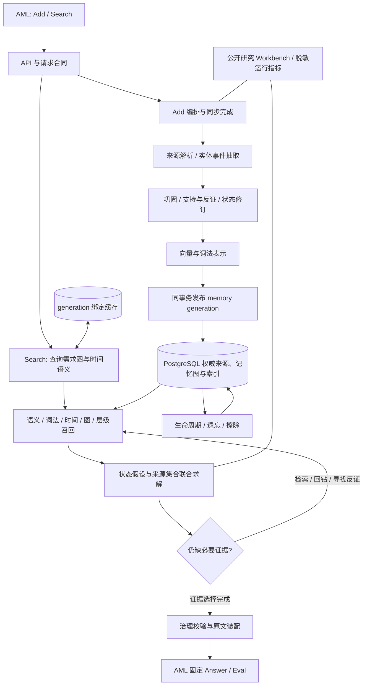

# EviEpoch 参赛系统技术设计

**版本：** 1.0 目标设计  
**日期：** 2026-10-27  
**产品合同：** [PRD](PRD.md)  
**依据：** [赛事与实现上下文](COMPETITION_CONTEXT.md) · [综述研究议程](../literature/survey-agenda.md) · [系统启发](../literature/systems/eviepoch-implications.md)

**实现进展：** 本文保留完整目标设计；当前分层代码、实际验收与未完成项见 [IMPLEMENTATION_STATUS](IMPLEMENTATION_STATUS.md)。开发验证按用户要求暂用 DeepSeek，正式模型合同不变。

本文定义拟实现的完整参赛架构。现有 FastAPI/SQLite 双通道 runner 为 B0 实验基线；下述记忆管理与联合取证模块是目标系统，不是对当前部署能力的描述。

## 1. 技术主张

采用统一来源与记忆生命周期底座，在同一个查询求解过程中联合决定：

1. 需要使用哪些实体、事实版本、事件、原因、规则与例外；
2. 哪些状态假设在问题所指时间和来源条件下成立；
3. 哪组原始证据能完整支撑这些假设，或展示尚未解决的分歧；
4. 在上下文、延迟和披露边界内，接下来最有价值的取证操作是什么。

写入侧执行有证据校验的分层巩固与可信修订，治理侧对选择性遗忘、失效、抑制和擦除使用不同语义。核心不是增加一个图数据库，而是让记忆对象、管理动作与查询效用具有可执行合同。

所有生成式解析/抽取/反思/规划使用 gpt-4o-mini，检索 embedding 使用 text-embedding-v4。独立 cross-encoder reranker 仅输出相关性/覆盖分数和候选 ID；训练数据来自公开或自建训练分区，不使用正式评测私有内容。

## 2. 系统架构

### 2.1 组件选型

| 组件 | 选型/职责 |
|---|---|
| HTTP 服务 | FastAPI；正式接口与现有公开路径映射保持合同一致 |
| 编排器 | 异步 I/O + 有界计算 worker，Add 请求一直等待最终提交；worker 不是提前成功的后台写入 |
| 权威数据 | PostgreSQL；来源、断言、事件、图、状态版本、治理、幂等账本 |
| 向量索引 | pgvector；精确与 HNSW 检索按工作负载配置，向量与来源处于同一事务域 |
| 词法索引 | user 作用域内 postings/document-frequency/BM25；多语言 tokenizer 版本固化 |
| 图/时间访问 | 关系边表、邻接索引、时间范围索引、递归/受预算图遍历；与来源共享 ID |
| 临时缓存 | Redis；只存可重建的 generation 绑定结果/计算缓存，不是权威事实 |
| Reranker | 独立批量评分服务；公开训练、固定模型与配置 |
| 归档与备份 | 加密对象存储/数据库备份；全部对象有来源与删除依赖记录 |
| 观测 | OpenTelemetry 与指标面板；公开研究可留完整 trace，正式私有运行仅必要脱敏元数据 |

图、向量、时间与状态共用 PostgreSQL 是事务与数据组织选择，已有 Cognee/Hindsight 先例。它不被单独作为原创贡献。

## 3. 数据模型与不变量

### 3.1 权威对象

所有主键/外键均包含 namespace_id；namespace 对应外部原样 user_id，内部映射使用不可逆 ID。session_id 只组织来源，不缩小 Search 的用户范围。

| 对象 | 核心字段 | 语义 |
|---|---|---|
| Namespace | id, external_user_id, committed_generation, policy_generation | 隔离边界与可见版本 |
| IngestRequest | namespace, request_id, payload_hash, status, lease, committed_generation | 幂等和处理进度；PENDING 不对 Search 可见 |
| SourceMessage | source_id, request/session, ordinal, role, original_content, source_timestamp, stored_at, hash | 权威原文，普通更新不改写 |
| SourceSpan | span_id, source_id, UTF-8 byte_start/end, text_hash | 精确来源；支持独立片段检索 |
| Entity/Mention | canonical_id, alias, type, mention_span, identity_confidence | 名称与同一性分开，保留同名分歧 |
| Assertion | subject, predicate, object/value, modality, cardinality, provenance, confidence | 一项可支持/反驳的陈述，不自动等于客观真值 |
| Event | event_type, participants, time_bounds, location, sources | 已发生/计划/假设事件分型 |
| Relation | from, to, type, support_spans, derivation, confidence, generation | 支持、反对、纠正、替代、时序、因果和规则依赖 |
| Summary/Scenario | scope, content, source_set, coverage_map, valid_scope, validation_state | 可回钻的情景/实体归纳 |
| Reflection/Procedure | hypothesis, applicability, premises, steps, exceptions, support/counterexamples | 经验与程序，区别于原始事实 |
| RetentionPolicy | target, action, effective_generation, source, state | 降活跃度、抑制或擦除 |
| Embedding/LexicalPosting | object_id, representation_version, vector/terms, namespace | 检索派生表示 |
| MemoryOperation | op_id, type, inputs, source_refs, before/after_refs, model/prompt/config, generation | 操作溯源；普通操作日志不复制私有正文 |

LLM 输出源句和消息序号，确定性代码再定位源片段并核验 hash；不信任模型直接生成的字符偏移。找不到来源的抽取项不能发布为已支持事实。

### 3.2 必须成立的不变量

- 任何输出内容都能定位到当前允许披露的 SourceMessage/SourceSpan。
- 任何派生对象都能沿依赖图追到原始来源，并在来源撤销后失效。
- 相同 request_id、相同 payload 只产生一次逻辑写入；不同 payload 不静默复用。
- Add 成功后，其来源、基础表示、声明的管理变化和治理状态在同一 generation 可见。
- 每次 Search 在一个已提交知识快照上求解；不使用未提交或该增量节点之后的数据。
- 历史失效不等于物理删除；治理禁止披露优先于历史查询。
- score 是检索相关性，不表示事实真值概率。
- Query/options/Agent 假设不是 Add 来源，不生成新的用户事实。
- 语义、词法统计、图扩散和缓存均不越过 namespace。

数据库行级策略与应用查询双重携带 namespace；服务角色不是 owner/superuser，不带 BYPASSRLS。连接池按事务设置作用域，不能依赖上一请求的会话变量。

## 4. 时间与事实状态

### 4.1 时间不是一个 created_at

每个断言/事件记录：

- asserted_at：来源陈述的时间；缺失时保留未知；
- stored_at / known_from_generation：系统何时记录并发布它；
- occurrence_time：事件何时发生；
- valid_time：属性/规则何时适用；
- precision 与 earliest/latest bounds：年/月/日/区间/不确定边界；
- anchor_span 与 derivation：相对日期如何由来源时间归一化。

使用半开区间 [start,end) 的精确值时，必须有足够证据；未知边界不是一个捏造的精确时间。计划/愿望/条件句不能覆盖已发生状态，晚写入的旧历史不能成为最新有效事实。

“现在”优先采用题内明确时间；否则绑定当前 user 已提交来源陈述所定义的时间视野，未来计划中的日期不扩大“当前”时点，不能用服务器今天日期随意解释历史样本。无法确定相对锚点时保留多个时间假设，由查询求解器联合取证。

### 4.2 状态与关系

- SUPPORTS：等值或相容证据，按独立来源计支持，重复转述不重复强化。
- SUPERSEDES：真实状态变化，旧事实仍可能在过去有效。
- CORRECTS：之前的陈述被纠正，可能追溯改变对旧陈述的判断。
- CONTRADICTS：同主体/同属性/重叠适用范围中存在不相容说法，尚不能当成变化。
- RETRACTS：源陈述被撤回。
- SUPPRESSES / ERASES：治理动作，与事实真值正交。

多值属性（兴趣、技能、多个联系人）不因出现新值就失效旧值；单值属性也需匹配情景和有效时间后才判冲突。状态保存在版本化投影与证据边上，而非改写原始文本。

### 4.3 查询条件化状态求解

对一个问题保留状态假设集合 H(q)，例如“2022 地址 X”“2024 后地址 Y”“源时间不明的替代说法”。当前、as-of、history、comparison、order、why 问题对同一组事实提出不同约束。

状态置信度结合来源直接性、实体一致性、时间可信度、独立支持和反证。权重在公开开发数据校准；LLM 自报数字不直接视为校准概率。用户自述在用户偏好/个人信息上比 Agent 推断更直接，外部规则/工具事实则按对应来源权威性处理，不能简单按 role 一刀切。

投影和取证循环相互反馈：候选状态决定需要什么证据；新来源可能推翻状态假设。不能先 latest-wins 决定唯一结果，再给它补证据。

## 5. 分层巩固

### 5.1 层级与双缓冲

| 层级 | 内容 | 检索用途 |
|---|---|---|
| L0 | 精确源消息/片段 | 事实核验、完整原文支持 |
| L1 | 实体、断言、事件和关系 | 精确属性/时间/路径查找 |
| L2 | 事件簇、会话情景、实体观察 | 场景恢复与全局导航 |
| L3 | 稳定偏好、受验证经验/规则/程序 | 复用约束与跨经历模式 |

新派生记忆先进入 hot 状态；校验来源、消歧、时间、重复和重要性后晋升。hot 与长期层都可检索，晋升不造成 Add 后不可见。原始来源保留与活跃索引选择分开：长期归档可通过精确源 ID、实体/时间和向量索引重新激活。

重要性评估采用当前可观察的显式承诺/约束、关键性、独特信息、跨经历支持、任务复用和冗余度，不使用未来问题或评测金标。罕见的否定、数字、日期、例外、安全关键事实有独立保护标记，不能被“访问少”逐出全部访问路径。

### 5.2 巩固合同

每次合并产生 Summary/Scenario 与 source coverage map，包含保留的主体、数值、时间、否定、例外和来源集合；新摘要不是新事实。质量检查包括源支持与关键信息保真。原始事实的冲突不能在摘要中无痕变成单一肯定陈述。

触发由新信息量、重复度、状态冲突、活跃工作集大小和空闲调度共同决定。后台重组只发布新的完整投影 generation；语义/治理变化不能以未版本化缓存覆盖。有限 hot 空间的处理是将完整来源转入可查询长期存储并释放重复派生缓存，不静默丢弃来源。

## 6. 可信反思、原因与程序

### 6.1 反思对象

反思状态为 hypothesis / supported / challenged / revised / retired。每条含适用范围、支持源、反例、独立证据计数和有效时间。observation 是来源归纳；reflection 是超出单条来源的经验判断，类型不同。

反思流程：从 Add 证据形成候选 → 检索独立支持及反例 → 检查适用域 → 校准置信度 → 发布带依赖的经验。新的反例可拆分适用条件或修订结论。没有新证据的重复检索不增加事实可信度。

Search 内部为取证生成的临时假设只服务当前问题；不把假设/选项/答案持久化为自述事实。公开实验可以对反思使用外部标注验证；正式评测数据不进入训练/离线产品分析。

### 6.2 因果边与程序图

关系类型区分 CAUSE_STATED、CAUSE_HYPOTHESIZED、BEFORE、ENABLES、REQUIRES、EXCEPT_IF、RULE_VERSION、RESULT_OF。时间先后和语义共现不直接升级为因果。

程序对象保存前提、步骤、例外、结果证据与适用情景。问题需要“如何执行/适用何规则”时，生成包含规则版本、相关事实、条件、例外和顺序的证据义务图。服务不替固定 Answer 生成执行结果。

图的节点与边均有来源；边扩散记录路径和每步支持。时间约束的矛盾/环进入待取证状态，不强行拓扑排序制造确定顺序。

## 7. 同步 Add 事务与并发

### 7.1 处理过程

1. 验证请求，按原样标识计算 namespace 与规范化 payload hash；hash 覆盖合同中的三个 ID 及有序消息的 role/content/timestamp，明确 absent/null 规范，不对正文做 strip 或 Unicode 改写。
2. 在幂等账本注册 PENDING/lease。相同 hash 已 COMMITTED 返回原成功标识；正在处理则合并等待或返回可重试状态；不同 hash 返回明确冲突错误。
3. 从已提交知识视图取必要实体/属性上下文。gpt-4o-mini 批量抽取 facts/events/preferences/procedures/governance，并对来源 quote、模态和时间做结构校验。
4. 对受影响实体/属性生成支持、更新、纠正、冲突、反例与巩固操作；生成所需索引表示。大模型调用在最终数据库事务之外，避免长时间持锁。
5. 最终事务检查依赖对象版本。若基准 generation 已变化，仅重算受影响的协调结果；保留原始消息，不以并发到达顺序当事件发生顺序。
6. 原子发布来源、所有在线索引/关系/状态/治理、幂等 COMMITTED 和新的 committed_generation。
7. 成功后响应原始 request/user/session ID。Redis 缓存不参与成功判定；缓存按 generation 读穿权威存储。

正式 Add 使用同步 200 合同。数据库作业状态可供内部恢复，但不将未完成工作当成功。关键模型阶段失败保留可恢复处理状态并返回明确错误，不把完整 profile 静默换成 raw-only。

### 7.2 并发一致性

同 request 使用租约/唯一约束；相同实体属性使用版本检查与最终事务协调，跨实体抽取可并行。Search 在读取已提交 generation 后使用同一快照，保证一次请求内部来源、状态与政策一致。

Streaming 的新 Add 或治理变化都会递增 generation；Query cache key 包含 namespace、generation、policy_generation、query/options hash、模型/prompt/配置版本。相同问题在新节点不能命中旧知识缓存。

## 8. Search：需求图、候选与联合求解

### 8.1 查询中间表示

QueryPlan 至少包含：

    {
      "intent": ["current", "as_of", "history", "order", "why", "procedure", "list", "global"],
      "entities": [],
      "attributes": [],
      "time_constraints": [],
      "evidence_obligations": [],
      "alternative_hypotheses": [],
      "required_relations": [],
      "privacy_scope": {},
      "search_actions": []
    }

原始 query 始终保留；改写用于补充查询，不替代原题。options 仅作为待核查主题/假设，不能当成真实事件或答案标签。所有控制动作输出结构化工具调用/ID，不能把规划文本塞进来源证据。

### 8.2 并行候选通道

| 通道 | 数据与信号 | 作用 |
|---|---|---|
| Dense | 原始片段、事件、事实、情景/摘要 | 同义改写与跨表达召回 |
| Lexical | 人名、数字、专有词、规则编号、多语言词项 | 精确标识和长尾内容 |
| Temporal | occurrence/valid time、区间、阶段和版本 | 时间约束内相关事实与覆盖 |
| Entity/Relation | 实体同一性、支持/反证、原因/规则路径 | 远距离与多跳依赖 |
| Hierarchy | L2/L3 导航回钻 L1/L0 | 长历史概览与范围缩小 |
| Counter-evidence | 与当前假设不相容的来源、旧版本/纠错 | 发现错误状态和确认偏误 |

初始用 RRF 或校准融合统一候选，再用 cross-encoder 估计 query/obligation/候选的关系。词法统计按 user 计算；Postgres 原生 tsvector rank 不冒充 BM25，全局 IDF 不能让其他样本数据影响本用户排名。

图扩散从实体/语义/时间锚点启动，按边类型和证据质量传播。图有界稀疏，不生成所有事件两两时间边；历史顺序和范围由时间索引支持。访问过的 source/span 去重，不因看过一个 session 就永久跳过整个 session。

### 8.3 联合优化目标

令 S 为返回的源证据集合，H 为问题下的状态/依赖假设，U 为必要证据义务：

    maximize J(S,H)
      = sum_u w_u * coverage(u, S, H)
        + alpha * relevance(S,q)
        + beta * temporal_and_source_consistency(S,H)
        + gamma * verified_dependency_support(S,H)
        - lambda * redundancy(S)
        - mu * token_cost(S)

约束：

- S 中每项存在允许披露的源片段；
- 数量 ≤ top_k，序列化后的总成本 ≤ 实际 Answer 证据预算；
- 状态/因果/程序结论要有完整来源路径；
- 真实未解冲突以替代假设与相应来源表达，不能为了提高一致性分数把反证丢掉；
- 已禁止披露内容不进入 S，即使问题指向历史时间。

coverage 使用 AND/OR 需求图：换工作与搬家的顺序至少需要两个时间前提；存在多套充分证据时允许任意一套，而非只有一组固定 gold ID。

实现采用 beam search over hypothesis/proof states + 按边际覆盖增益/成本的证据扩展，保留替代状态。选择器可对候选状态和来源包交换/补齐；所有结果回到源 span。该选择器是研究主张核心，需要与“相同候选 + 独立 Top-K”和“相同预算 + greedy cover”比较。

### 8.4 取证控制循环

控制器执行 PLAN、SEARCH、TRAVERSE、PROJECT_TIME、FIND_COUNTEREVIDENCE、DRILL_DOWN、SELECT、FINISH。每次动作带未满足义务与可检查依据。

终止条件为证据义务满足、现有来源确实不足，或按 query class 声明的调用/token/延迟预算耗尽。预算控制用于统一实验与服务调度，完整功能不会因未实现而用其他 profile 冒充。结束时只装配已有证据，不填造缺口。

## 9. 证据装配与外部接口

公开 Add 请求、响应与 Search 字段遵循 [当前官方合同](COMPETITION_CONTEXT.md)。服务本地路由可继续 /add、/search，网关把提交路径映射到它们。

### 9.1 证据单元

以写入时确定的源消息/片段为稳定单位，ID 由 namespace + request + ordinal + span/version 稳定导出。动态组合的临时段落不伪装成稳定记忆。

content 只含原始语言的源文本与确定性的真实来源标记（时间/role）。不输出“所以答案是 Y”、未经来源验证的摘要、生成式状态说明或诱导 Answer 的指令。因果/纠正/规则通过源句本身及序列顺序交付，内部 metadata 不被视作平台会读取的字段。

返回以证据对查询的边际贡献和依赖组组织，组内可按时间排列；不在最后执行无条件 raw-first 重排破坏已计算顺序。所有返回项都是来源证据，派生事实仅参与索引。

### 9.2 响应示例

    {
      "data": [
        {
          "id": "src_opaque_stable_id",
          "content": "[2024-06-12T09:00:00Z][user] I moved to Shenzhen in May.",
          "score": 0.92,
          "created_at": "2024-06-12T09:00:00Z"
        }
      ]
    }

top_k 是最大条数，不强制填满。score 如返回，须与最终排序语义一致；created_at 使用可核验的来源时间，缺失时不补造。无结果返回 data=[]。

实际预算包含 query/options、平台包裹文本、每项标记与源文字；本地现有 117760 是 runner 配置，不能当成官网保证的 Answer 输入上限。冻结时将实际合同预算和 tokenizer 写入 manifest。

### 9.3 错误语义

格式/空正文为 400/422，鉴权失败为 401；in-flight 请求冲突与临时容量状态明确区分。429/503 携带合理 Retry-After。相同 ID 的重试不得重复计数或发布部分数据。服务 deadline、反向代理、模型调用与官方请求上限组成一致的链路超时配置。

## 10. 遗忘与治理的执行

### 10.1 四类操作

| 操作 | 在线效果 | 来源处理 |
|---|---|---|
| Deactivate | 减少活跃工作集，可被适当查询重新激活 | 仍可恢复，不宣称删除 |
| Invalidate/Supersede | 限制某事实/规则的适用区间 | 历史来源保留 |
| Suppress | 对指定范围禁止检索/披露 | 立即影响所有来源装配 |
| Erase | 删除在线原文和派生对象，追踪备份擦除完成 | 仅保留不含内容的治理凭据 |

忘记指令通过 Add 的来源处理，不要求平台发送额外 delete 字段。target 包括主体/属性/来源范围、截至何 generation 和是否持续禁止存储；模糊目标不擅自扩大到全部用户数据。

### 10.2 派生链清理

通过来源依赖闭包定位 raw spans、facts、events、summary、reflection、relations、postings、vectors 和 cache。受污染摘要重新生成或失效；包含被禁止值的删除指令自身也不得通过返回原文泄漏目标。

在线发布 tombstone 与清理在 Add 成功前生效；历史请求重试、缓存、索引重建和备份恢复必须应用最新治理账本。备份副本有独立清理任务与完成记录，未完成不记为“全副本物理擦除完成”。

正式运行数据按赛事保留期限清理，包括 jobs/staging、模型缓存、备份和调试副本；公有研究集与私有运行空间物理/逻辑分开。

## 11. 存储、索引与规模

namespace hash 分片；实体/事实/图关系和 postings 索引前缀包含 namespace。大用户分区/索引与普通用户分桶的策略在 manifest 中固定，不按 benchmark 名称或 user_id 内部字符串猜测数据集。

向量查询在用户范围内返回足够候选；ANN 的后置过滤不能导致跨用户候选先占满池。使用分区/过滤感知扫描和候选补足，并用精确检索对照测 ANN recall。写入增量向量在权威索引提交后即可访问，不依赖未完成的外部索引刷新。

容量以实际对象数估计，而不是把 300M tokens 当 300M memory：
- 设 M 为向量对象数，d 为实际维度，float32 payload 为 4Md bytes；
- 图边按稀疏邻接度统计，不做 O(M²) 全连接；
- 记录原文、派生文本、postings、向量、图、WAL、缓存、备份的实际放大率；
- 使用普通/长尾/单大用户/Streaming/并发混合工作负载测 p50/p95/p99 和完成总时长。

数据源默认向量维度可沿用 1024，但模型、维度、预处理、tokenizer、ANN 和融合配置一起版本化；更改后重建对应索引，不混用旧向量。

## 12. 控制器、调度与成本

一个控制协议覆盖任务类型，不为公开 benchmark 名称特制规则。调度器分别管理 embedding、gpt-4o-mini、reranker 和数据库容量，按 RPM/TPM/GPU batch/数据库资源约束调度同步请求。

预算按任务复杂度分配，但每次调用、输入输出 tokens、候选数和图激活量可归因。全量成本模型采用真实 Add chunk 数、每 chunk 抽取/协调调用、原文/派生 embedding tokens，以及 Streaming 实际 Search 次数；不把 6000 实例直接等同 6000 Search，不以固定 token-to-word 系数推算官方切分。

Search 的收益成本由同条件实验评估；更新策略也报告总 Add 工时和模型调用。高吞吐并发通过分片和批处理获得，不能以提前返回成功隐藏工作量。

## 13. 研究评测设计

### 13.1 数据与协议

公开研究使用 conversation/user 隔离的 train/dev/sealed-test；同源模板、同一人的会话和派生变体不跨分区泄漏。结合 LoCoMo、LongMemEval、MemoryAgentBench 的公开合法部分、偏好/规则任务与综述衍生控制场景。

Answer 模型、prompt、judge、token/调用预算、数据切片和种子固化。若未取得与正式平台一致的 pipeline hash，本地结果标为代理评测，不称官方 Overall。正式私有输入只完成评测，不进入本地重建集、训练或事后内容分析。

证据标注支持多套充分集合/等价源与 AND/OR 依赖，不要求只有唯一 gold_ids。没有证据应拒答与必须披露某证据分别标注，避免“空结果提高隐私分”掩盖召回失败。

### 13.2 强基线

| ID | 基线 |
|---|---|
| B0 | 当前 EviEpoch commit 的双通道向量 runner |
| B1 | 原文 Dense + user-BM25 + session-RRF + 邻域扩展 |
| B2 | 允许模型配置下的 TEMPR 风格多路/图/时间检索 |
| B3 | 同固定 Answer、同预算的上下文基线，明确截断/全量条件 |
| B4 | latest-wins / hard-overwrite / append-only 时间策略对照 |
| FULL | 完整管理、联合状态/依赖与来源集合选择 |

不能用论文中的 GPT-OSS/Gemini/Claude 成绩代替这些匹配基线。

### 13.3 支撑主张的消融

| 研究问题 | 必要实验 | 观察 |
|---|---|---|
| 巩固不丢失 | 无巩固 / 破坏性摘要 / 完整可回钻巩固；去关键事实保护 | 关键/长尾事实存活、来源完整、活跃空间与成本 |
| 因果取证 | 去因果边 / 打乱边 / 只时间邻域 / 完整因果支持 | 语义远距离原因、链方向、路径支持率 |
| 可信反思 | 无反思 / 只正向强化 / 源验证 / 反证驱动 | 错误传播、修正率、外域泛化 |
| 安全遗忘 | TTL / 主表删除 / 完整依赖闭包 | 泄漏、复活、无关信息误删 |
| 状态与集合联合 | 独立 Top-K / 先定状态 / greedy cover / 联合求解 | Current+Historical、完整前提、最终答案 |
| 跨能力效用 | 去规则/例外层、去场景偏好、去缺口迭代 | A/B/C/D/E/G/H 的效果分布 |

四个主要机制做 2×2×2×2 交互实验，避免把交互增益归到单一组件。选择器对照固定相同候选；召回对照固定集合选择器；同时报告等 token/调用预算与完整运行成本。

### 13.4 指标

- 任务：固定 Answer 正确率、公开数据集标准指标、每能力切片及配对置信区间。
- 记忆：等价证据 Recall、Complete Evidence Rate、因果/规则路径支持、Current/As-of 正确、罕见事实保真、错误 supersession、反思修订。
- 效率：Add/Search 分阶段延迟、p95/p99、总完成时长、tokens/调用、索引放大与缓存。
- 治理：cross-user leakage、suppression/erase 漏洞、重放复活、错误删除、源引用有效性。

## 14. 可观测性与运行

公开研究 Workbench 按一次交互呈现“来源 → 抽取 → 管理 diff → 需求图 → 候选路径 → 选中源 → 固定 Answer”，并能定位写入、巩固、召回、状态推断、集合遗漏与 Answer 推理的责任。

正式私有运行关闭正文/推理内容调试日志，仅记录必要计数、耗时、错误、版本、不可读标识与官方允许的复核信息。源内容留在完成任务所需的受控记忆存储中，不复制到监控/分析服务。

部署采用独立运行的计算与持久数据库，统一 HTTPS 网关、健康/就绪探针和版本指标。现有 ECS 转发 + 桌面宿主是已记录基线拓扑；目标发布使用固定镜像与持久服务拓扑，资源和 provider 配额由 PRD 工作负载定义。

数据库备份、恢复和 schema/index 迁移都有 namespace/generation/治理账本校验。恢复不能回滚删除政策或把新版向量误配旧模型。重试恢复必须沿用相同 request_id 与 payload。

## 15. 代码组织与当前迁移

建议目标模块：

    eviepoch/
      api/                 # 官方合同、鉴权与请求生命周期
      domain/              # 来源、实体、时间、断言、程序和治理类型
      ingest/              # 抽取、源片段核验、幂等编排
      manage/              # 巩固、反思、状态投影与反证修订
      retrieval/           # query plan、多路候选、图激活、联合选择
      governance/          # suppression、erase、保留与派生闭包
      storage/             # PostgreSQL/pgvector/postings、版本与事务
      providers/           # 固定模型、reranker、调用计量
      observability/
    experiments/
      datasets/            # 清单/哈希/适配器，私有数据不入库
      evaluate/
      ablations/
      reports/
    workbench/

旧 SQLite 数据迁移到独立候选数据库，保留旧 ID 映射、request ledger、源时间与 embedding identity。现存展示字符串无法证明原始 payload 字节完全一致时，标记为 legacy_source；从合法原始输入重新导入的研究运行可得到精确源。公开旧版本保持可复现，新的发布版本独立绑定 commit/镜像/schema。

本次工作只写设计与研究材料，不把此目录结构描述为已完成代码。

## 16. 验收与冻结产物

实现验收覆盖接口和状态不变量、时间/因果/程序语义、巩固保真、反思修订、遗忘闭包、Streaming/并发一致性、统一端到端质量与真实模型公网容量。

正式 release manifest 至少包括：
- git commit、镜像 digest、schema/索引/迁移版本；
- embedding/LLM/reranker 名称与实际 provider、维度、预处理、prompt hash；
- 控制预算、融合/集合优化参数、tokenizer、source rendering 版本；
- 公开研究 data manifest、split、pipeline hash、基线与消融配置；
- 部署端点/鉴权方案/资源/实际并发声明、容量报告与 Smoke ID；
- 上游仓库/作者/commit、许可和修改说明；
- Full Run/Suite/Pipeline/数据版本标识及受控保留/删除记录。

截止与 Full 次数按 [赛事上下文](COMPETITION_CONTEXT.md) 执行。运行 Full 前冻结实际部署版本和方法配置，评测进程不接收人工修改记忆或调换算法。

## 17. PRD 需求追踪

| PRD 需求 | 本设计章节 | 验收资产 |
|---|---|---|
| F01–F02 来源/可追溯抽取 | §3、§7、§9 | 源片段校验、引用完整率、原文 round-trip |
| F03–F05 实体/时间/状态 | §3–§4 | 同名/多值、历史/当前、变化/纠正/计划场景 |
| F06 巩固 | §5 | 关键事实保真与活跃空间对照 |
| F07 可信反思 | §6 | 支持/反例、适用域、纠错与传播实验 |
| F08 遗忘 | §10 | 全派生闭包、缓存/重放/备份恢复验证 |
| F09–F11 查询与联合取证 | §8 | 需求图、路径支持、等预算选择器消融 |
| F12 证据交付 | §9 | API、排序、条数、序列化 token 和 source ID |
| F13 Streaming | §7、§10 | generation 可见性、更新/删除后的重复查询 |
| F14 隔离/证据边界 | §3、§8–§10 | 跨 user、选项假前提、无答案和敏感范围场景 |
| F15 Workbench | §14 | 公开样本的完整操作与证据 diff |
| F16 容量 | §11–§12、§14 | 真实 provider/公网混合负载报告 |
| F17 可复现 | §13、§16 | manifest、pipeline/data hash、许可与版本绑定 |
